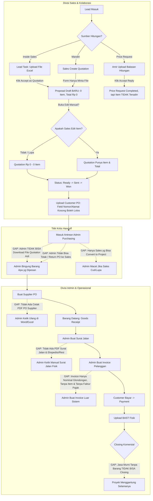

# Analisis Komprehensif Flow Sistem: Kolaborasi Sales ↔ Admin & Teknisi
## Penelusuran Celah Alur Quotation, Pengolahan Berkas, Handoff Operasional, Penagihan, hingga Closing Proyek

- **Tanggal Analisis:** 5 November 2026
- **Lokasi Repositori:** `/var/www/3dyapp` (Branch `main`)
- **Fokus Pemeriksaan:** Modul Penawaran Harga (*Quotation/Proposals*), *Inside Sales Task*, *Price Request* Teknisi, Handoff Admin (*Customer PO*), *Procurement* (*Supplier PO*), Logistik (*Surat Jalan*), Penagihan (*Invoice & Faktur Pajak*), hingga *BAST & Closing Komersial*.
- **Tujuan Dokumen:** Memetakan seluruh titik putus (*disconnects*), inkonsistensi antarmuka (UI/UX), kelemahan validasi bisnis (*business logic gaps*), dan celah pengolahan berkas fisik/digital yang menyebabkan sistem terasa masih "mentah" saat diuji coba oleh operasional.

---

## 1. Ringkasan Eksekutif & Akar Masalah (The Core Dilemma)

Berdasarkan pengujian alur langsung di dalam kode dan antarmuka saat ini, modul Sales dan Admin sebenarnya telah memiliki fondasi skema database yang cukup luas (tabel `proposals`, `supplier_purchase_orders`, `goods_receipts`, `goods_deliveries`, `invoices`, `bast`). Namun, alur tersebut terasa **"sangat mentah, membingungkan, dan rawan salah"** saat dipakai karena adanya **3 Akar Masalah Utama**:

```
+----------------------------------------------------------------------------------------------------+
|                                    AKAR MASALAH UTAMA SISTEM                                       |
+-----------------------------------+--------------------------------+-------------------------------+
|  1. DILEMA FILE VS DATA ITEM      |  2. TIADANYA GERBANG KONTROL   |  3. KETERPUTUSAN BERKAS       |
|                                   |     (NO FORMAL GATEKEEPER)     |     (FILE HANDOFF LOSS)       |
| Form "Create Quotation" hanya     | Quotation bernilai Rp 0 dan    | Admin di halaman handoff      |
| meminta upload file tanpa form    | Customer PO tanpa nomor/alamat | TIDAK BISA mengunduh file     |
| input item. Sebaliknya, modul     | bisa lolos sampai ke Admin.    | quotation asli. Admin dipaksa |
| Admin butuh item terstruktur      | Admin tidak bisa tolak/kembali-| kerja buta jika item database |
| untuk Supplier PO & Surat Jalan.  | kan berkas yang tidak lengkap. | kosong (berbasis file).       |
+-----------------------------------+--------------------------------+-------------------------------+
```

1. **Dilema "Berbasis File" vs "Berbasis Data Terstruktur":**
   - Saat Sales membuat penawaran di `/sales/proposals/create`, sistem **hanya meminta upload file PDF/Excel** dan tidak menyediakan input rincian item barang/jasa.
   - Akibatnya, penawaran tersimpan dengan **total Rp 0 dan 0 item**.
   - Namun, saat berpindah ke divisi Admin untuk belanja (*Supplier PO*) dan pengiriman (*Surat Jalan*), sistem Admin **membutuhkan data item terstruktur** (nama barang, kuantitas, part number). Ketika itemnya kosong, seluruh alur Admin macet atau menghasilkan transaksi Rp 0.
2. **Ketiadaan Gerbang Verifikasi (*No Formal Gatekeeper*):**
   - Transisi status dari `draft` → `ready` → `sent` → `accepted` tidak memiliki validasi nominal (`grand_total > 0`).
   - Customer PO bisa diunggah tanpa nomor PO, tanpa tanggal, dan tanpa alamat kirim.
   - Admin tidak memiliki tombol **"Verifikasi PO"** maupun **"Kembalikan ke Sales (Return with Notes)"**. Alur bersifat "jalan satu arah tanpa kontrol kualitas".
3. **Keterputusan Berkas (*File Handoff Disconnect*):**
   - Di halaman Admin Handoff (`/admin/purchasing/{proposal}`), Admin hanya diberi tombol unduh untuk file Customer PO. **Admin TIDAK BISA mengunduh file Quotation asli** yang diunggah oleh Sales/Inside Sales. Jika item di database kosong, Admin sama sekali tidak tahu barang apa yang harus dibeli ke supplier.
   - Supplier PO, Surat Jalan, dan Invoice **tidak dapat menghasilkan dokumen cetak / PDF resmi dari sistem**, sehingga Admin tetap harus bekerja manual menggunakan Excel/Word di luar aplikasi.

---

## 2. Peta Alur: Alur Riil Saat Ini (As-Is) vs Alur Ideal B2B (To-Be)

### 2.1 Diagram Alur Kondisi Riil Saat Ini (Banyak Titik Putus)



---

## 3. Penelusuran Celah Menyeluruh per Tahap (Deep-Dive Gap Analysis)

---

### TAHAP 1: Pembuatan & Pengolahan Quotation di Menu Sales

#### 1. Form Pembuatan Quotation Hanya File Upload (`sales.proposals.create`)
- **Temuan di Kode:** Pada view `resources/views/sales/proposals/create.blade.php`, form pembuatan quotation HANYA berisi input:
  1. `quotation_file` (diwajibkan / `required` di HTML baris 37)
  2. `proposal_date`
  3. `valid_until`
  4. `notes`
- **Celah & Dampak Fatal:**
  - Tidak ada input baris item (`items`), tidak ada harga satuan, tidak ada diskon per item, dan tidak ada pilihan termin pembayaran.
  - Saat form disimpan, `ProposalController::store` membuat proposal berstatus `draft` dengan `grand_total = 0`.
  - Sales yang tidak paham mengira penawaran sudah selesai dibuat karena file sudah terunggah, padahal **di mata database penawaran ini bernilai Rp 0**.
  - Untuk mengisi item, Sales harus masuk ke halaman detail (`show.blade.php`), lalu mengklik tombol **Edit** yang baru memanggil partial `_form.blade.php`. Alur ini tidak lazim, membingungkan pengguna baru, dan menciptakan risiko human error yang sangat tinggi.

#### 2. Keterputusan Integrasi Inside Sales (`LeadTask` → `Proposal`)
- **Temuan di Kode:** Di `LeadTaskController::acceptQuotationAttachment`, ketika Sales mengklik *"Accept as Quotation"* dari berkas yang diunggah Inside Sales:
  - Sistem membuat `Proposal` baru otomatis.
  - Berkas dipindahkan sebagai lampiran (`ProposalAttachment`).
  - Item dibuat **0 baris** dan `grand_total` menjadi **Rp 0**.
- **Celah & Dampak Fatal:**
  - Sistem tidak menyediakan antarmuka bagi Sales untuk mengonversi berkas Inside Sales menjadi item terstruktur.
  - Tidak ada validasi yang mengunci penawaran: Sales bisa langsung menekan tombol `Ready` → `Send` → `Accept` tanpa pernah melengkapi itemnya.
  - Jika Inside Sales mengunggah 3 versi berkas di satu task, Sales bisa menekan *"Accept as Quotation"* 3 kali sehingga tercipta 3 Quotation terpisah untuk satu kebutuhan yang sama.

#### 3. Keterputusan Integrasi Price Request Teknisi (`PriceRequest` → `Proposal`)
- **Temuan di Kode:** Di `PriceRequestController`, Sales meminta perhitungan ke Pricing Engineer (Amir). Amir mengunggah file balasan versi 1, versi 2, dst. Sales menyetujui versi tertentu (`acceptReply`) hingga status menjadi `completed`.
- **Celah & Dampak Fatal:**
  - Saat Sales mengklik link buat quotation dari Price Request (`/sales/proposals/create?price_request_id=...`), sistem hanya mengisi input hidden `price_request_id`.
  - Hasil perhitungan, angka margin, dan rincian harga dari Engineer **sama sekali tidak tampil di layar pembuatan quotation**.
  - Form tetap meminta Sales mengunggah berkas baru.
  - Kolom `accepted_reply_id` tidak disimpan di tabel `proposals`, sehingga sistem tidak bisa membuktikan apakah harga yang ditawarkan ke customer sama persis dengan versi balasan yang disetujui tim teknis.

#### 4. Ketiadaan Gerbang Status Penawaran (*No Quotation Validation Gates*)
- **Temuan di Kode:** Method `markReady`, `send`, dan `respond` di `ProposalController`:
  - `markReady()` hanya mengecek `status === 'draft'`.
  - `send()` hanya mengecek `status === 'ready'`.
  - `respond('accepted')` langsung mengubah lead menjadi `won`.
- **Celah & Dampak Fatal:**
  - **Sistem membiarkan penawaran kosong (0 item, Rp 0) dikirim ke klien dan disetujui (Won).**
  - Di database aktual saat ini, tercatat 4 quotation dan seluruhnya bernilai Rp 0 karena ketiadaan validasi minimal 1 baris item dan `grand_total > 0`.

#### 5. Dokumen Penawaran Belum Memenuhi Standar Legalitas Multi-PT
- **Temuan di Kode:** View `preview.blade.php` hanya berupa tampilan HTML sederhana yang mengandalkan tombol cetak browser (`window.print()`).
- **Celah & Dampak Fatal:**
  - Kop surat bertuliskan generik **"3DY GROUP"**, tanpa nama resmi badan hukum PT (PT NTI, PT MGK, PT TPS, PT WANI), tanpa NPWP perusahaan, alamat legal, dan nomor rekening resmi per PT.
  - Nomor quotation menggunakan urutan global `Q/YYYY/MM/XXXX`, tidak mengadopsi kode PT Group (contoh: `001/NTI-Q/XI/2026`).
  - Tidak ada fitur unduh berkas PDF resmi yang terkunci (*immutable snapshot*) saat penawaran disetujui pelanggan.

---

### TAHAP 2: Handoff Sales → Admin (Customer PO & Verifikasi Berkas)

#### 1. Validasi Customer PO yang Sangat Longgar di Backend
- **Temuan di Kode:** Pada `ProposalController::uploadPo`:
  ```php
  'po_file' => [$proposal->po_document_path ? 'nullable' : 'required', 'file', 'max:10240', ...],
  'po_number' => 'nullable|string|max:100',
  'po_date' => 'nullable|date',
  'delivery_deadline' => 'nullable|date',
  'delivery_address' => 'nullable|string|max:255',
  ```
- **Celah & Dampak Fatal:**
  - Di antarmuka UI ada tanda bintang merah / peringatan, tetapi **di backend seluruh field bersifat nullable** kecuali file jika baru pertama kali.
  - Sales bisa mengunggah file sembarang (misal screenshot WA) tanpa nomor PO, tanpa tanggal PO, tanpa tanggal batas kirim (*delivery deadline*), dan tanpa alamat pengiriman.
  - Begitu file terunggah, status quotation langsung berubah menjadi **"PO Received — Ready for Purchasing"** dan masuk ke radar Admin.

#### 2. Ketiadaan Input Nilai PO Customer (*Quotation Value vs PO Value*)
- **Temuan di Kode:** Tabel `proposals` tidak memiliki kolom `po_amount`.
- **Celah & Dampak Fatal:**
  - Dalam praktik nyata pengadaan barang B2B, nilai pada PO Klien sering kali berbeda dengan Quotation awal (misalnya: customer membulatkan nominal, memotong kuantitas item tertentu, atau ada PPN yang dihitung berbeda).
  - Karena tidak ada pencatatan nominal PO, Admin tidak bisa melakukan rekonsiliasi nilai: apakah PO yang masuk nilainya sama dengan penawaran atau ada selisih.
  - Tidak ada prosedur *Change Order* atau *Quotation Revision after PO*.

#### 3. Ketiadaan Tombol Verifikasi & Pengembalian Berkas oleh Admin
- **Temuan di Kode:** Controller `PurchasingHandoffController` bersifat murni *Read-Only*. Antrean hanya hasil query:
  `Proposal::where('status', 'accepted')->whereNotNull('po_document_path')`.
- **Celah & Dampak Fatal:**
  - Admin **TIDAK MEMILIKI AKSI** terhadap PO yang masuk. Tidak ada tombol:
    - `[Verifikasi PO Sesuai]`
    - `[Kembalikan ke Sales / Return to Sales]` disertai catatan kekurangan (misal: "Alamat kirim gudang belum ada", "Nomor NPWP klien salah", "PO belum ada tanda tangan basah").
  - Akibatnya, jika ada PO bermasalah, Admin harus menegur Sales lewat WhatsApp pribadi di luar aplikasi. Tidak ada jejak audit (*audit trail*) di dalam sistem.

#### 4. File Quotation Asli HILANG dari Layar Admin Handoff
- **Temuan di Kode:** Pada `resources/views/admin/purchasing/handoff/show.blade.php`:
  - Tombol yang tersedia hanya: `Download PO` (`route('sales.proposals.download-po')`).
  - Controller `PurchasingHandoffController::show` tidak me-load relasi `attachments`.
- **Celah & Dampak Fatal:**
  - **Admin sama sekali tidak bisa melihat atau mengunduh berkas penawaran harga asli** yang diunggah oleh Sales / Inside Sales.
  - Padahal, jika penawaran tersebut dibuat dari jalur berkas (di mana tabel itemnya kosong/Rp 0), Admin tidak memiliki petunjuk sama sekali mengenai apa yang harus dibeli ke supplier. Admin terpaksa meminjam akun Sales atau meminta berkas dikirim ulang via WhatsApp.

#### 5. Bottleneck Operasional: Hanya Sales Owner yang Bisa Convert to Project
- **Temuan di Kode:** Pada `ProposalController::convertToProject`:
  `$this->authorizeManage($proposal);` yang mewajibkan `isOwner` (`auth()->id() === created_by` atau `assigned_to`).
- **Celah & Dampak Fatal:**
  - Admin, Purchasing, dan Management **DILARANG** menekan tombol *Convert to Project* (akan memicu error `403 Forbidden`).
  - Di sisi lain, Admin **tidak bisa membuat Surat Jalan jika belum ada Project** (karena `goods_deliveries.project_id` wajib ada).
  - Jika staf Sales sedang cuti, sakit, atau resign, proses pengadaan dan pengiriman barang terhenti total karena Admin tidak bisa membuatkan project pengganti.

---

### TAHAP 3: Pengolahan oleh Admin - Pengadaan & Supplier PO

#### 1. Kerancuan Konsep 3 Jenis PO di Menu Admin
- **Temuan di Kode:**
  1. *Customer PO* (disimpan di `proposals`, dilihat di `admin/purchasing`).
  2. *Supplier PO* (disimpan di `supplier_purchase_orders`, dilihat di `admin/supplier-pos`).
  3. *Legacy Purchase Order* (tabel `purchase_orders`, rute `admin/pos`).
- **Celah & Dampak Fatal:**
  - Di sidebar Admin masih terpampang menu **"Purchase Order"** lama.
  - Di halaman Admin Hub masih ada tombol **"+ Buat PO"** yang mengarah ke `admin.pos.create`.
  - Ketika Admin mengisi form tersebut dan klik Simpan, sistem memunculkan layar putih error **`403 Forbidden: Legacy Customer PO is read-only. Use the Quotation handoff for new Customer PO`**.
  - Ini membuat pengguna Admin merasa aplikasi rusak atau memiliki bug fatal.

#### 2. Supplier PO Tidak Bisa Dicetak Menjadi Dokumen PDF
- **Temuan di Kode:** `SupplierPurchaseOrderController` hanya memiliki tampilan layar (`show.blade.php`), tanpa method cetak/PDF.
- **Celah & Dampak Fatal:**
  - Ketika Admin ingin memesan barang ke distributor/supplier (misal: Hikvision, Dahua, Schneider, distributor kabel), Admin **tidak bisa men-generate dokumen PO berformat PDF** yang memiliki kop PT 3DY, nomor telepon supplier, termin pembayaran, dan tanda tangan purchasing.
  - Admin terpaksa mengetik ulang data barang ke template Microsoft Word/Excel manual untuk dijadikan PDF dan dikirim via email/WA ke vendor.

#### 3. Bug Partial Sourcing: Hilangnya Quotation dari Antrean Siap Belanja
- **Temuan di Kode:** Pada `AdminService::getHubData()` baris 547-550:
  ```php
  $quotationDealQuery = Proposal::with(['lead.customer', 'project'])
      ->where('status', 'accepted')
      ->whereNotNull('po_document_path')
      ->whereDoesntHave('supplierPurchaseOrders', fn ($q) => $q->where('status', '!=', 'cancelled'));
  ```
- **Celah & Dampak Fatal:**
  - Query mengasumsikan 1 Quotation = 1 Supplier PO.
  - Kenyataannya, 1 Quotation sering kali terdiri dari bermacam-macam barang yang harus dibeli ke **beberapa supplier berbeda** (contoh: CCTV dibeli ke Supplier A, Tiang/Bracket dibeli ke Bengkel B, Kabel dibeli ke Distributor C).
  - Begitu Admin membuat Supplier PO pertama untuk Supplier A, quotation tersebut **LANGSUNG HILANG dari antrean "Quotation Deals Ready for Supplier PO"**.
  - Admin kehilangan pengingat barang apa saja yang belum dibelanjakan ke Supplier B dan C.

#### 4. Prefill Harga Modal yang Berpotensi 0
- **Temuan di Kode:** Di `SupplierPurchaseOrderController::create`, harga modal diambil dari `$item->product?->cost_price ?? 0`.
- **Celah & Dampak Fatal:**
  - Jika item quotation adalah item non-katalog (custom) atau jasa instalasi teknis, kolom `product_id`-nya null.
  - Akibatnya harga modal prefill menjadi Rp 0. Jika Admin tidak teliti mengisi harga beli asli, Supplier PO akan terbit dengan total belanja Rp 0.

---

### TAHAP 4: Pengiriman ke Pelanggan - Surat Jalan & Ekspedisi Logistik

#### 1. Surat Jalan Tidak Memiliki Dokumen Cetak / PDF Resmi
- **Temuan di Kode:** `GoodsDeliveryController` hanya menyimpan database pengiriman dan mencatat kuantitas terkirim di `supplier_purchase_order_items`.
- **Celah & Dampak Fatal:**
  - Surat Jalan adalah dokumen legal yang **wajib dibawa secara fisik** oleh driver/kurir atau ditempel pada kardus paket pengiriman.
  - Sistem tidak memiliki generator PDF Surat Jalan resmi (dengan kop PT, nomor Surat Jalan, rincian kuantitas, serial number perangkat, dan kolom tanda tangan 3 pihak: Pengirim, Driver, dan Penerima Gudang Klien).
  - Admin tetap harus membuat Surat Jalan fisik manual di Microsoft Word/Excel.

#### 2. Ketiadaan Dukungan Pengiriman Ekspedisi Pihak Ketiga
- **Temuan di Kode:** Tabel `goods_deliveries` hanya memiliki field `recipient_name` dan `notes`.
- **Celah & Dampak Fatal:**
  - Untuk proyek luar kota/pulau, pengiriman barang dilakukan via ekspedisi (JNE, J&T Cargo, Dakota, Indah Cargo, Lalamove).
  - Sistem tidak memiliki field untuk mencatat:
    - Nama Ekspedisi / Kurir
    - Nomor Resi / Waybill (AWB)
    - Biaya Pengiriman (Ongkir)
    - Bukti foto resi pengiriman
  - Akibatnya status pengiriman luar kota tidak dapat dilacak secara transparan di dalam aplikasi.

#### 3. Status "Delivered" Tanpa Validasi Bukti Penerimaan
- **Temuan di Kode:** Tombol update status `GoodsDeliveryController::updateStatus` mengizinkan pengubahan langsung menjadi `delivered` tanpa mewajibkan unggah berkas bukti tanda terima (scan Surat Jalan basah / foto serah terima).
- **Celah & Dampak Fatal:**
  - Status `delivered` langsung memicu `evaluateCommercialClosing()`.
  - Proyek bisa dianggap selesai secara pengiriman meskipun barang aslinya masih di perjalanan atau belum sampai di tangan customer.

---

### TAHAP 5: Penagihan Pelanggan - Invoice, Termin & Faktur Pajak

#### 1. Invoice Pelanggan Tanpa Line Items (Tagihan Glondongan)
- **Temuan di Kode:** Form `resources/views/admin/invoices/create.blade.php` dan tabel `invoices`:
  - Hanya menyimpan: `customer_id`, `project_id`, `proposal_id`, `amount`, `invoice_type`, `due_date`, `notes`, dan lampiran file.
  - **TIDAK ADA tabel `invoice_items`**.
- **Celah & Dampak Fatal:**
  - Sistem tidak bisa mencantumkan rincian item barang/jasa apa saja yang sedang ditagihkan pada invoice tersebut.
  - Sistem **tidak bisa meng-generate PDF Invoice tagihan resmi**.
  - Admin hanya bisa mengunggah berkas PDF Invoice yang telah dibuat di software akuntansi luar (Accurate / Excel / Word). Sistem ini hanya berfungsi sebagai tempat arsip file, bukan sistem penagihan mandiri.

#### 2. Ketiadaan Modul Faktur Pajak (e-Faktur) Sama Sekali
- **Temuan di Kode:** Tidak ada tabel, model, controller, maupun view yang menangani Faktur Pajak.
- **Celah & Dampak Fatal:**
  - Setiap transaksi kena pajak wajib menerbitkan Faktur Pajak dengan Nomor Seri Faktur Pajak (NSFP) dari DJP.
  - Customer korporat/instansi **tidak akan membayar invoice sebelum menerima Faktur Pajak asli**.
  - Di sistem saat ini, tidak ada pencatatan:
    - Nomor Seri Faktur Pajak (NSFP)
    - Tanggal Faktur Pajak
    - DPP (Dasar Pengenaan Pajak), PPN 11%/12%, dan PPh 23
    - Tautan file PDF e-Faktur pada invoice terkait
  - Staf Finance/Admin tidak memiliki kontrol terhadap status faktur pajak mana yang belum diterbitkan dan mana yang sudah dikirim ke customer.

#### 3. Ketiadaan Manajemen Jadwal Termin (*Payment Schedule*)
- **Temuan di Kode:** Pada `proposals`, ada field `payment_scheme` (`full`, `dp`, `tempo`), `dp_percent`, dan `term_days`.
- **Celah & Dampak Fatal:**
  - Tidak ada entitas jadwal termin yang terstruktur (contoh proyek termin bertahap: DP 30% setelah PO, Termin 50% setelah barang sampai lokasi, Pelunasan 20% setelah BAST).
  - Saat Admin menerbitkan invoice DP, proyek tersebut langsung hilang dari query `readyToInvoiceQuery` di Admin Hub (karena query hanya mengecek `doesntHave('invoices')`).
  - Sistem tidak memiliki pengingat kapan termin berikutnya harus ditagihkan kepada customer, sehingga penagihan sisa sering terlewat.

#### 4. Validasi Penagihan Berlebih (*Over-Invoicing*) Belum Ada di Tingkat Database
- **Temuan di Kode:** Pada `AdminService::createInvoice()`, tidak ada validasi apakah `sum(invoices.amount) + new_amount > proposal.grand_total`.
- **Celah & Dampak Fatal:**
  - Admin bisa salah mengetik angka nol tambahan (misal tagihan 100 juta tertulis 1 milyar) dan sistem tetap menerbitkannya.

---

### TAHAP 6: Penyelesaian Pekerjaan & Commercial Closing (BAST & Project Finish)

#### 1. Deadlock Closing untuk Penjualan Jasa Murni & Retail
- **Temuan di Kode:** Logika penutupan otomatis di `Project::evaluateCommercialClosing()`:
  ```php
  $deliveryQuery = $this->goodsDeliveries();
  $deliveryDone = (clone $deliveryQuery)->exists()
      && (clone $deliveryQuery)->where('status', '!=', 'delivered')->doesntExist();

  $installationDone = ! $this->requires_installation
      || (filled($this->bast_number) && ((int) $this->progress >= 100 || strcasecmp((string) $this->status?->name, 'Done') === 0));

  $invoiceQuery = $this->invoices();
  $invoiceDone = (clone $invoiceQuery)->exists()
      && (clone $invoiceQuery)->whereNotIn('status', ['paid', 'cancelled'])->doesntExist();
  ```
- **Celah & Dampak Fatal:**
  - **Kasus Jasa Murni (Tanpa Barang Fisik):** Jika proyek adalah jasa konsultasi, maintenance tahunan, atau jasa instalasi saja tanpa pengadaan barang dari 3DY, tidak akan pernah ada `goods_deliveries`. Karena `(clone $deliveryQuery)->exists()` bernilai false, **proyek jasa TIDAK AKAN PERNAH BISA CLOSING**.
  - **Kasus Jual Putus / Retail (Tanpa Instalasi Teknisi):** Pelanggan hanya membeli barang jadi (box moving). Di sistem saat ini, alur dipaksa membuat Project teknisi lengkap dengan `work_type_id`, sehingga proyek menggantung menunggu status teknisi.

#### 2. Ketiadaan Fitur Manual Override Closing
- **Temuan di Kode:** Tidak ada fungsi penutupan manual oleh Management / Admin dengan catatan alasan khusus (misal: penyelesaian sengketa, diskon pembulatan akhir, pemotongan piutang).

---

### TAHAP 7: Hak Akses & Kolaborasi Tim (Role Matrix & Notifikasi)

#### 1. Pembatasan Role Finance yang Menyebabkan Error 403
- **Temuan di Kode:** Di `RoleAndPermissionSeeder.php`, role `finance` hanya memiliki izin `view-admin` dan `view-admin-hub`, **TIDAK MEMILIKI `manage-admin`**.
- **Celah & Dampak Fatal:**
  - Di `PurchasingHandoffController::show`, akses penuh membutuhkan `manage-admin`. Staf Finance yang menerima notifikasi handoff dan mengklik tautan di email/lonceng akan mendapati layar putih **`403 Forbidden`**.
  - Staf Finance yang bertugas mencatat pembayaran dan invoice tidak bisa membuat invoice atau payment jika controller mewajibkan izin `manage-admin`.

#### 2. Ketiadaan Tab Monitoring Terpadu bagi Sales (*Sales Visibility Gap*)
- **Temuan di Kode:** Halaman penawaran Sales (`sales.proposals.show`) hanya menampilkan status PO.
- **Celah & Dampak Fatal:**
  - Sales tidak memiliki panel transparansi untuk memantau:
    1. Apakah Supplier PO sudah dikirim ke vendor?
    2. Apakah barang sudah tiba di gudang kantor?
    3. Nomor resi Surat Jalan pengiriman ke customer berapa?
    4. Apakah invoice penagihan sudah lunas dibayar klien?
  - Akibatnya Sales terus-menerus menanyakan hal tersebut ke tim Admin melalui WhatsApp pribadi, mengganggu produktivitas harian.

---

## 4. Matriks Celah, Dampak & Prioritas Solusi

Berikut adalah matriks komparasi seluruh celah yang ditemukan, diurutkan berdasarkan tingkat urgensi penyelesaian:

| No | Modul / Tahap | Deskripsi Celah Temuan | Dampak Operasional | Tingkat Urgensi | Rekomendasi Solusi Teknis |
|:---|:---|:---|:---|:---:|:---|
| **1** | **Sales Quotation** | Form Create hanya meminta upload file, tanpa baris item & harga. | Quotation bernilai Rp 0 dan 0 item, Admin tidak bisa belanja. | **P0 (Kritis)** | Gabungkan form item & rincian harga ke form `create.blade.php`. File menjadi opsi lampiran, bukan pengganti data item. |
| **2** | **Inside Sales** | Tombol *Accept as Quotation* membuat proposal draft Rp 0 tanpa item. | Data terputus, laporan omzet kosong, Admin tidak punya data item. | **P0 (Kritis)** | Wajibkan konversi item terstruktur sebelum proposal bisa diubah ke status `ready` atau `send`. |
| **3** | **Quotation Gate** | Quotation Rp 0 bisa di-set `ready`, `sent`, dan `accepted` (Won). | Deal fiktif masuk ke antrean Admin. | **P0 (Kritis)** | Tambahkan validasi: minimal 1 baris item dan `grand_total > 0` sebelum boleh `markReady` atau `send`. |
| **4** | **Admin Handoff** | Admin **TIDAK BISA mengunduh file Quotation asli** di halaman handoff. | Admin buta barang apa yang harus dibeli jika item database kosong. | **P0 (Kritis)** | Tampilkan daftar lampiran penawaran asli di `/admin/purchasing/{proposal}` lengkap dengan tombol unduh. |
| **5** | **Admin Handoff** | Admin tidak bisa memverifikasi atau menolak (return) Customer PO. | Kontrol kualitas berkas bocor; PO salah tetap diproses. | **P0 (Kritis)** | Tambahkan tombol aksi Admin: `[Verify PO]` dan `[Return to Sales with Notes]`. |
| **6** | **Project Convert** | Hanya Sales Owner yang bisa klik *Convert to Project*. | Operasional macet jika Sales cuti/sakit; Surat Jalan tidak bisa dibuat. | **P0 (Kritis)** | Berikan izin fallback *Convert to Project* kepada Admin & Management. |
| **7** | **Legacy PO Menu** | Menu lama "Purchase Order" masih ada dan memunculkan error `403`. | Admin bingung, tombol "+ Buat PO" terlihat rusak. | **P0 (Kritis)** | Sembunyikan menu legacy, arahkan seluruh tombol "+ Buat PO" ke `Supplier Purchase Order`. |
| **8** | **Closing Proyek** | Proyek jasa murni tanpa barang tidak bisa closing otomatis. | Proyek jasa menggantung selamanya (*deadlock*). | **P0 (Kritis)** | Tambahkan flag `requires_delivery = false` untuk jasa murni; trigger closing via BAST Jasa. |
| **9** | **Supplier PO** | Supplier PO tidak memiliki dokumen cetak / generator PDF resmi. | Admin mengetik manual berkas PO di luar sistem. | **P1 (Penting)** | Buat template cetak/PDF Supplier PO dengan kop PT Group 3DY. |
| **10** | **Surat Jalan** | Surat Jalan tidak bisa dicetak dan belum mendukung ekspedisi (resi). | Logistik pengiriman luar kota tidak terlacak resmi di sistem. | **P1 (Penting)** | Tambahkan template PDF Surat Jalan + field nama ekspedisi, resi (AWB), dan bukti foto terima. |
| **11** | **Faktur Pajak** | Modul Faktur Pajak belum ada sama sekali di sistem (0%). | Kepatuhan pajak tidak tercatat, rekonsiliasi finance terpisah. | **P1 (Penting)** | Bangun modul Faktur Pajak terhubung ke Invoice (NSFP, DPP, PPN, upload file e-Faktur). |
| **12** | **Invoice Tagihan** | Invoice tidak memiliki line item rincian barang/jasa. | Tidak bisa mencetak tagihan resmi dari web, hanya upload file. | **P1 (Penting)** | Tambahkan tabel `invoice_items` yang tersalin dari quotation atau input termin. |
| **13** | **Termin Pembayaran** | Tidak ada jadwal termin bertahap (*payment schedule*). | Penagihan sisa/pelunasan sering terlewat setelah DP lunas. | **P1 (Penting)** | Buat tabel `proposal_payment_schedules` untuk mengontrol antrean tagihan per termin. |
| **14** | **Partial Sourcing** | Quotation hilang dari antrean belanja begitu 1 Supplier PO dibuat. | Sisa item belanja ke vendor lain rawan terlupakan. | **P1 (Penting)** | Ubah filter antrean belanja: hanya hilang jika SEMUA item quotation sudah dibuatkan PO supplier. |
| **15** | **Hak Akses Finance** | Role Finance terkunci read-only dan mengalami error 403 saat handoff. | Finance tidak bisa menjalankan tugas pembuatan invoice dan payment. | **P1 (Penting)** | Berikan permission pembuatan invoice/payment kepada Finance dan perbaiki otorisasi handoff. |
| **16** | **Legalitas Multi-PT** | Kop dokumen masih "3DY GROUP" global tanpa badan hukum PT. | Dokumen belum memenuhi legalitas transaksi perpajakan. | **P2 (Normal)** | Integrasikan kop surat, logo, NPWP, dan rekening bank per PT Group (NTI/MGK/TPS/WANI). |
| **17** | **Sales Visibility** | Sales tidak bisa melihat timeline status pengadaan & penagihan. | Sales terus menerus bertanya manual via WA ke Admin. | **P2 (Normal)** | Buat tab ringkasan progres operasional (Procurement, Delivery, Invoicing) di detail quotation Sales. |

---

## 5. Rekomendasi Rencana Aksi Pembenahan (Actionable Roadmap)

Untuk menyelesaikan masalah ini secara rapi tanpa merusak sistem yang sedang berjalan, pembenahan disarankan dilakukan dalam **3 Fase Terukur**:

```
+---------------------------------------------------------------------------------------------------+
|                                   ROADMAP PEMBENAHAN SISTEM                                       |
+-----------------------------------+-------------------------------+-------------------------------+
|  FASE 1: INTEGRITAS DATA & GATE   |  FASE 2: OTOMATISASI DOKUMEN  |  FASE 3: CLOSING & FINANCE    |
|             (P0)                  |             (P1)              |             (P1-P2)           |
| • Form Create Quotation ada item  | • Template PDF Quotation      | • Modul Faktur Pajak Lengkap  |
| • Validasi grand_total > 0        | • Template PDF Supplier PO    | • Jalur Jasa Murni (No Goods) |
| • Admin bisa download file quote  | • Template PDF Surat Jalan    | • Jadwal Termin Pembayaran    |
| • Admin bisa Verify/Return PO     | • Input Ekspedisi & Resi AWB  | • Dashboard Status bagi Sales |
| • Fallback Convert to Project     | • Line Items pada Invoice     | • Legalitas Kop Multi-PT      |
+-----------------------------------+-------------------------------+-------------------------------+
```

### Fase 1: Perbaikan Gerbang Alur Data & Eliminasi Blocker (Paling Mendesak)
1. **Perbaikan Form Create Quotation (`sales.proposals.create`):**
   - Hapus pemisahan antara "hanya upload file" dan "edit item".
   - Masukkan partial `_form.blade.php` langsung ke dalam halaman `create.blade.php`, sehingga saat membuat penawaran, Sales langsung mengisi item, kuantitas, harga, dan skema pembayaran. Unggah file menjadi opsi lampiran dokumen pendukung.
2. **Kunci Gerbang Status Quotation:**
   - Tambahkan validasi di `ProposalController::markReady` dan `send`: wajib memiliki minimal 1 item dan `grand_total > 0`.
3. **Lengkapi Berkas di Layar Admin Handoff:**
   - Di `admin/purchasing/{proposal}`, tampilkan daftar seluruh berkas quotation asli (`$proposal->attachments`) lengkap dengan tombol unduh agar Admin dapat melihat berkas asli Sales/Inside Sales.
4. **Implementasikan Verifikasi PO Admin:**
   - Tambahkan status verifikasi PO: `po_verified`, `po_returned`.
   - Buat tombol aksi bagi Admin: `[Verifikasi PO]` dan `[Kembalikan ke Sales]` dengan alasan penolakan yang otomatis memunculkan notifikasi ke Sales.
5. **Fallback Convert to Project:**
   - Izinkan peran `admin`, `management`, dan `super-admin` untuk melakukan `convertToProject` jika Sales berhalangan.
6. **Bersihkan Menu Legacy PO:**
   - Sembunyikan menu `admin/pos` dari navigasi dan arahkan tombol "+ Buat PO" di Admin Hub ke `SupplierPurchaseOrderController@create`.

### Fase 2: Otomatisasi Dokumen Cetak & Logistik Pengiriman
1. **Generator PDF Resmi Sistem:**
   - Bangun template PDF standar menggunakan library PDF (misal DomPDF / Snappy):
     - PDF Penawaran Harga (*Quotation*)
     - PDF Pesanan Pembelian Pemasok (*Supplier PO*)
     - PDF Surat Jalan Pengiriman (*Goods Delivery Note*)
     - PDF Faktur Tagihan (*Invoice*)
2. **Ekspedisi Logistik pada Surat Jalan:**
   - Tambahkan kolom `delivered_by_type` (`internal_driver` / `expedition`), `expedition_name`, `tracking_number`, `shipping_cost`, dan unggah foto resi / foto Surat Jalan basah.
3. **Invoice Line Items:**
   - Tambahkan tabel `invoice_items` agar invoice tagihan memuat rincian pekerjaan dan kuantitas barang secara resmi.
4. **Perbaiki Antrean Sourcing Sisa Barang:**
   - Perbaiki query `quotationDealQuery` di `AdminService` agar penawaran tidak hilang dari antrean belanja selama masih ada item yang kuantitas pesan supplier-nya belum mencukupi kuantitas quotation.

### Fase 3: Faktur Pajak, Jadwal Termin & Penyempurnaan Closing
1. **Pembangunan Modul Faktur Pajak:**
   - Buat relasi `faktur_pajaks` pada `invoices`: nomor seri faktur pajak, DPP, tarif PPN, nominal PPh, dan lampiran file e-Faktur resmi dari DJP.
2. **Jadwal Termin Pembayaran (*Payment Schedule*):**
   - Buat pengontrol jadwal penagihan berdasarkan skema pembayaran penawaran (DP, Termin II, Pelunasan) yang memunculkan antrean tagihan secara otomatis di Admin Hub sesuai progres pekerjaan.
3. **Perbaikan Evaluasi Closing Komersial:**
   - Pisahkan jalur proyek jasa murni: jika `requires_delivery = false`, proyek tidak membutuhkan verifikasi Surat Jalan untuk dapat closing komersial, melainkan cukup verifikasi BAST Serah Terima Pekerjaan dan Pelunasan Invoice.
4. **Transparansi Progres untuk Sales:**
   - Buat tab ringkas *"Operational Tracking"* di halaman detail penawaran Sales yang menampilkan status real-time dari pengadaan di Admin, pengiriman di lapangan, hingga pembayaran invoice di finance.

---

## 6. Kesimpulan

Keluhan bahwa sistem saat ini **"masih sangat mentah dan banyak yang kurang pas"** sepenuhnya valid dan terbukti nyata di dalam kode program:
- Sistem saat ini baru berupa **kumpulan tabel database yang berdiri terpisah**, namun **belum memiliki jembatan logika dan dokumen resmi** yang mengikatnya.
- Penawaran berbasis file yang menghasilkan nominal Rp 0, ketiadaan tombol unduh berkas penawaran di sisi Admin, tidak adanya verifikasi Customer PO, hilangnya quotation dari antrean belanja saat baru dibeli sebagian, invoice tanpa rincian item, ketiadaan Faktur Pajak, serta ketidakmampuan sistem mencetak PDF resmi adalah penyebab utama alur kerja terasa manual dan terputus.

Dengan mengikuti panduan celah dan matriks perbaikan pada dokumen ini, tim pengembang dapat melakukan penyempurnaan alur kerja Sales ↔ Admin secara terarah, presisi, dan aman tanpa mengganggu kestabilan sistem operasional lainnya.

