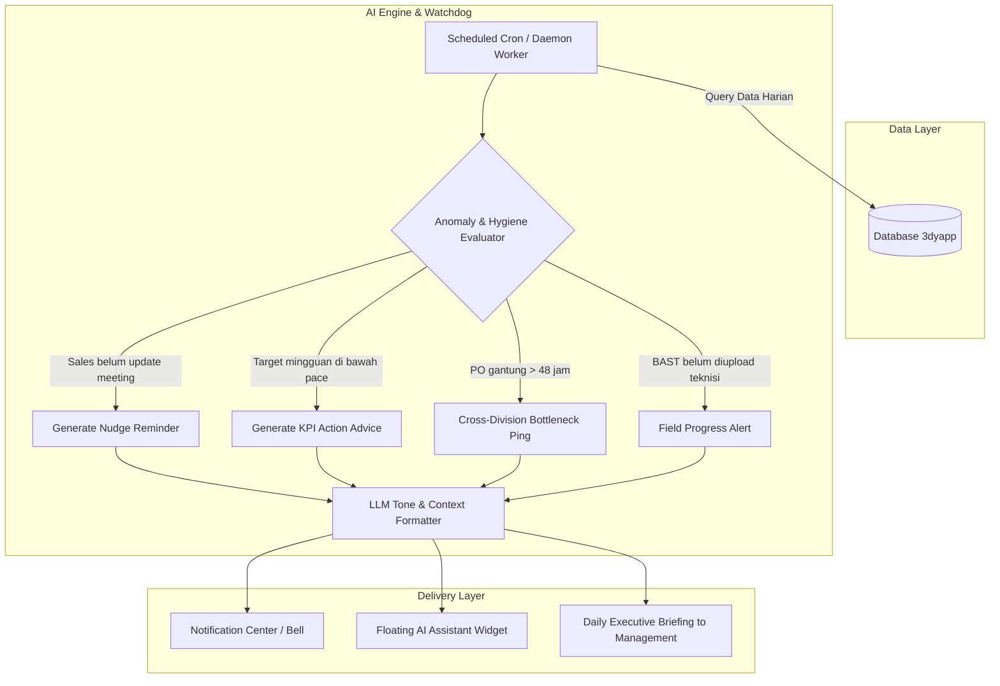
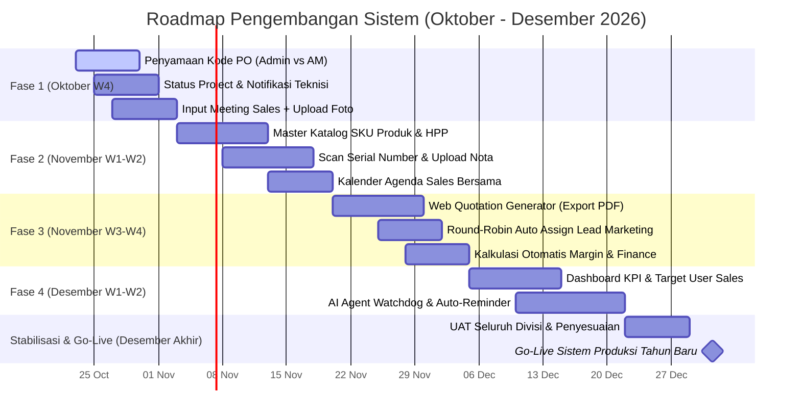

# Roadmap Pengembangan Sistem & Blueprint AI Agent (Target: Desember / Tahun Baru)
**Dokumen Referensi Pengembangan Web 3dyapp**  
*Tanggal Dibuat: 23 Oktober 2026*  
*Target Peluncuran: Desember 2026 (Ready for Production Tahun Baru)*

---

## 1. Ringkasan Eksekutif & Hasil Rapat Manajemen

Dokumen ini disusun berdasarkan hasil evaluasi bersama Manajemen (Pak Bos) dan Senior Divisi Admin mengenai kendala operasional, kesenjangan komunikasi antar-divisi, serta kebutuhan otomatisasi sistem untuk mendukung operasional penuh seluruh divisi pada akhir tahun 2026.

### Masalah Utama Saat Ini:
1. **Silo & Kesenjangan Informasi:** Teknisi sering tidak mengetahui apakah sebuah project masih berjalan atau sudah closed.
2. **Inkonsistensi Data PO:** Perbedaan penomoran PO antara Sales/Account Manager (PO dari Customer) dengan Divisi Admin (PO Pembelian/Internal).
3. **Pencatatan Lapangan Belum Tervalidasi:** Aktivitas meeting sales harian belum terekam rapi (belum ada bukti visual dan dokumentasi kesepakatan tertulis).
4. **Pencatatan Barang Manual:** Belum tersedianya katalog master produk baku, input Serial Number (SN) masih manual, dan nota fisik rentan hilang.
5. **Keterbatasan Beban Marketing:** Inbound leads yang masuk membutuhkan pembagian manual yang membebani tim marketing.

---

## 2. Rincian Solusi per Modul Divisi

### A. Monitoring Sales & Lapangan
* **Daily Meeting Report (Foto + MOM):**
  * Setiap agenda meeting wajib di-*update* dengan melampirkan foto dokumentasi (selfie/suasana meeting) dan Minutes of Meeting (MOM).
  * Field isian: Tanggal/Jam, Nama Klien, Poin Pembahasan, *Next Action*, dan Status Prospek.
* **Kalender Jadwal Sales Harian:**
  * Visibilitas jadwal harian tim sales untuk manajemen dan sesama rekan kerja.
  * Memudahkan alokasi koordinasi jika ada meeting bersama teknisi/pre-sales.
* **Dashboard KPI & Target Sales:**
  * Metrik: Target meeting mingguan vs realisasi, pipeline conversion (Lead → Deal), dan perolehan nominal PO.
  * Tampilan *progress bar* dan leaderboard target per Account Manager.

### B. Admin, Gudang, & Finance
* **Master Kode Produk (SKU Catalog):**
  * Standardisasi nama barang, kategori, merk, spesifikasi, HPP (Harga Pokok Pembelian), dan harga jual acuan.
  * Menghindari ketidaksinkronan penamaan di penawaran dan pembelian.
* **Scan Serial Number (SN) & Digitalisasi Nota:**
  * Input Serial Number berbasis scan kamera/barcode scanner saat barang diterima atau diserahkan ke teknisi.
  * Upload foto/scan nota pembelian vendor untuk kemudahan klaim garansi dan audit keuangan.
* **Kalkulator Keuangan Terpadu:**
  * Perhitungan otomatis PPN (11%), diskon bertingkat, dan estimasi Gross Margin per transaksi.
  * Digitalisasi Quotation generator langsung dari web berbasis kop surat resmi (menghilangkan format manual Word/Excel).

### C. Harmonisasi Lintas Divisi (Solusi Kasus Khusus)
* **Status Project Teknisi Terbuka vs Tertutup:**
  * State Machine Project: `New / Pending Assignment` → `In Progress` → `Waiting BAST / Approval` → `Closed`.
  * Saat Berita Acara Serah Terima (BAST) di-upload dan disetujui, sistem otomatis mengirim notifikasi ke teknisi bahwa project telah resmi *Closed*.
* **Sinkronisasi Kode PO (Admin vs AM):**
  * Penyediaan dua field relasi yang saling terhubung:
    * `Customer PO Number`: Nomor PO resmi dari klien yang dibawa oleh AM.
    * `Internal PO / Admin Ref Number`: Nomor referensi pemesanan internal admin.
  * Kedua nomor tampil berdampingan dalam satu detail project sehingga pencarian dengan nomor mana pun menghasilkan data yang sama.
* **Lead Inbound Auto-Distribution (Marketing):**
  * Mengurangi beban operator marketing dengan mekanisme *Round-Robin Auto-Assignment* ke sales aktif secara merata.

---

## 3. Blueprint AI Agent Proaktif (Smart Operational Watchdog)

AI Agent pada web 3dyapp dirancang bukan hanya sebagai chatbot tanya-jawab pasif, melainkan sebagai **asisten operasional otonom** yang memantau kesehatan data dan kelancaran proses bisnis.

### Kemampuan & Skenario AI Agent:

1. **Anomaly & Activity Reminder (Sales):**
   * *Kondisi:* Sales memiliki jadwal meeting terjadwal hari ini, namun hingga pukul 17:00 belum ada notulensi atau foto terunggah.
   * *Aksi AI:* Mengirim notifikasi ramah via Notification Center/Widget:  
     > *"Halo [Nama Sales], sistem mencatat agenda meeting dengan [Klien] hari ini belum ada dokumentasi. Yuk upload foto dan hasil pertemuannya sebelum jam kerja berakhir agar masuk ke rekapan harianmu!"*

2. **Pacing Target & Evaluasi KPI Mingguan:**
   * *Kondisi:* Target sales adalah 5 meeting/minggu. Pada hari Kamis, sales baru menyelesaikan 2 meeting.
   * *Aksi AI:* Memberikan analisis gap:  
     > *"Pencapaian meeting mingguan: 2/5 (40%). Untuk mencapai target, kamu memerlukan 3 meeting lagi dalam 2 hari ke depan. Terdapat 4 lead berpotensi tinggi di pipeline kamu yang siap dihubungi."*

3. **Deteksi Bottleneck Antar-Divisi:**
   * *Sales → Admin:* *"Customer PO dari PT ABC telah di-upload oleh AM 3 hari lalu, namun PO Internal belum diterbitkan oleh Admin. Rekomendasi: Segera proses pemesanan barang."*
   * *Teknisi → Finance:* *"Instalasi lapangan untuk Project #102 sudah selesai 2 hari lalu, namun berkas BAST belum di-upload oleh Teknisi. Project tertahan untuk penagihan invoice."*

4. **Executive Morning Briefing (Manajemen & Pak Bos):**
   * Setiap pukul 08:30 WIB, AI menyiapkan rangkuman singkat untuk manajemen:
     * Rekap meeting sales kemarin.
     * Daftar project yang tertahan/stuck.
     * Progres pencapaian omzet bulan berjalan terhadap target.

---

## 4. Timeline & Roadmap Implementasi Menuju Desember / Tahun Baru

---

## 5. Rencana Arsitektur Database (Tabel Pendukung Baru / Penyesuaian)

1. **`sales_meetings`**
   * `id`, `user_id`, `customer_id`, `scheduled_at`, `completed_at`, `mom_notes`, `photo_path`, `status` (*scheduled, completed, cancelled*).
2. **`products` (Master SKU)**
   * `id`, `sku_code`, `name`, `category`, `brand`, `base_cost` (HPP), `suggested_price`, `unit`.
3. **`product_serials` & `purchase_receipts`**
   * `id`, `product_id`, `project_id`, `serial_number`, `purchase_receipt_id`, `warranty_expiry`.
4. **`projects` (Penyempurnaan Kolom PO & Status)**
   * `customer_po_number` (String, nomor dari klien).
   * `internal_po_number` (String, nomor dari admin).
   * `project_status` (*new, in_progress, waiting_bast, closed*).
   * `bast_file_path`, `bast_approved_at`.
5. **`ai_nudges` / `operational_alerts`**
   * `id`, `target_user_id`, `division`, `alert_type` (*missing_meeting_report, stalled_po, missing_bast, kpi_lag*), `message`, `is_read`, `created_at`.

---

## 6. Checklist Eksekusi Minggu Ini (Quick Wins)
- [ ] Buat field `customer_po_number` & `internal_po_number` pada form dan detail project.
- [ ] Buat status badge transparan untuk teknisi (Project Active vs Closed).
- [ ] Buat modul input Meeting Sales (Upload foto dokumentasi + ringkasan hasil).
- [ ] Siapkan basis query watchdog untuk mendeteksi sales yang belum update agenda hariannya.
