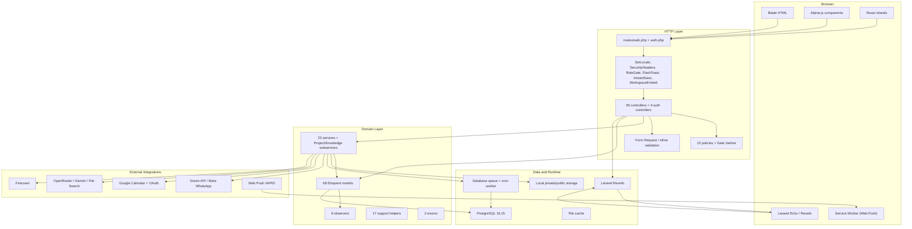

# Application Architecture

**Audit:** Phase 1 - CRM Application Architecture
**Repository:** `/var/www/3dyapp`
**Date:** 2026-11-23
**Mode:** Read-only inspection

## 1. Architecture at a Glance

The application is a server-rendered Laravel monolith with four presentation mechanisms:

1. Blade templates rendered by controllers.
2. Livewire components for chat and a small admin list.
3. Alpine.js for page-level interactivity and modal/dropdown state.
4. React islands for the notification center, toast viewport, glide select, and decorative segmented control.

The domain layer is a mix of:

- Controllers with inline business rules.
- Service classes for multi-step or reused workflows.
- Eloquent models with status constants, scopes, and small domain helpers.
- Observers for lifecycle side effects.
- Policies and support classes for authorization.

## 2. Request Lifecycle

A typical authenticated page request:

1. `bootstrap/app.php` loads `routes/web.php`, registers middleware aliases, and appends web middleware.
2. Global web middleware includes `SetLocale`, `SetSecurityHeaders`, `EnsureUserHasRole`, `InstantSaveResponse`, `FlashActionToast`, and `PropagateWorkspaceEmbed` (`bootstrap/app.php:34-52`).
3. Route permission middleware (`permission:...`) checks Spatie permissions; there are 83 inline permission checks in `routes/web.php`.
4. Controller validates input inline, calls a policy or custom authorization helper, then calls a service, model, or direct query.
5. Service/model writes may trigger observers (`CustomerObserver`, `ProjectObserver`, `SurveyObserver`, `InstalasiObserver`, `SizingProjectObserver`, `PriceRequestObserver`).
6. Controller returns a Blade view, a redirect with flash data, or JSON for AJAX calls.
7. `FlashActionToast` adds a default success message for mutation redirects; `InstantSaveResponse` converts redirects to JSON for eligible AJAX forms.
8. Blade renders the layout, includes the sidebar/header, and mounts React islands and Alpine stores.

A typical AJAX request:

- GET filters may return a rendered partial (`customers.index` checks `$request->ajax()` at `CustomerController.php:67-73`).
- POST/PUT/DELETE may return JSON `{ok, message, redirect}` from `InstantSaveResponse`.
- Notification endpoints return JSON directly (`NotificationController`).
- WhatsApp webhooks bypass session/CSRF and use signature/shared-secret checks (`WhatsAppCenterController.php:558-654`).

## 3. Layer Responsibilities

### 3.1 HTTP and routing

- `routes/web.php` is the active route registry: 988 lines, 432 unique route names, 12 separate `sales.` groups, and 83 permission checks.
- `routes/auth.php` holds login, Google OAuth, password reset, verification, and logout.
- `bootstrap/app.php` also registers scheduling, exception rendering, and CSRF exceptions.
- Route files for admin, admin-panel, marketing, monitoring, and teknisi are orphaned.

**Assessment:** Routing is permission-oriented and readable in short blocks, but the single file has become a coordination point for every division. The repeated `sales.` prefix blocks make it hard to see the sales route surface as one unit.

### 3.2 Controllers

- 65 top-level controller files plus 9 auth controllers.
- 20,579 lines in top-level controllers.
- Four controllers exceed 1,000 lines: `LeadController` (1,375), `ProposalController` (1,213), `WhatsAppCenterController` (1,143), `ManageSalesController` (1,007).
- Controllers often contain validation, authorization, queries, transactions, notifications, file handling, and status transitions.

**Assessment:** Controllers are the primary orchestration layer, but several have become application services with an HTTP interface. The project convention says controllers should be thin (`3dy-architecture` skill), so this is a deliberate deviation that has accumulated over time.

### 3.3 Services

23 top-level services plus `Project/` (3) and `Knowledge/` (3). The strongest service boundaries are:

- `CustomerLifecycleService`: lead-to-customer promotion.
- `LeadPipelineService`: lead status transition guards.
- `SalesService`: follow-up lifecycle.
- `AdminService`: invoice, PO, payment, document snapshot.
- `ProcurementService`: receipt/delivery/invoice recalculation.
- `ProjectWorkflowService`: project step evaluation and sync.
- `DocumentRegistry`: single source for module-owned files.
- `QuotationNumberService`, `QuotationVersionService`, `QuotationPdfService`: quotation plumbing.

**Assessment:** Services exist for the most reused workflows, but not for all high-risk ones. Quotation creation, project creation, and lead intake still have controller-level implementations, sometimes duplicated.

### 3.4 Models and observers

- 68 models; 33 use `SoftDeletes`.
- Status constants exist for `Lead`, `Proposal`, `Invoice`, `PriceRequest`, `TechnicalRequest`, `LeadTask`, `FollowUp`, `SupplierPurchaseOrder`, `GoodsReceipt`, `GoodsDelivery`, and `SupplierInvoice`.
- `Project` status is dynamic via `project_statuses`; `App\Enums\ProjectStatus` covers only labels/colors.
- Observers handle soft-delete cascades, project activity, project workflow sync, and customer promotion on project creation.
- `CustomerObserver` and `ProjectObserver` cascade soft delete/restore to projects, contacts, documents, tasks, and supports.

**Assessment:** The observer layer is useful but creates hidden side effects. For example, deleting a customer cascades to projects and documents, and creating a project promotes a lead customer to `deal` (`ProjectObserver.php:35-40`).

### 3.5 Support helpers

17 support classes carry cross-cutting rules:

- `PtAccess`: PT write scoping.
- `CustomerAccess`: customer visibility.
- `DocumentAccess` / `DocumentCenterAccess`: document visibility.
- `Pricing`, `Rupiah`: money/margin.
- `PageContext`: breadcrumb and workspace tab metadata.
- `NotificationPresenter`: notification payload.
- `SparklineBuilder`: KPI history.

**Assessment:** These helpers are the closest thing to a shared domain kernel. They are consistently used by policies and controllers, but they are static utility classes rather than injected domain services, which makes them easy to call from anywhere and hard to mock.

## 4. Architectural Patterns

### 4.1 Permission-gated route groups

Routes are grouped by `permission:` middleware, with finer checks inside controllers. This is simple and visible, but it creates two authorization layers that can drift.

### 4.2 Policy plus custom authorization helpers

Policies cover record-level rules for Customer, Lead, Project, ProjectDocument, Proposal financial fields, PriceRequest, Product, EstimatorRequest, Monitoring, and ProjectStatus. Several controllers still use private `authorizeX()` helpers instead of policies (LeadController, ProposalController, LeadTaskController).

### 4.3 Read models

`DocumentCenterService` builds a union query across project documents, quotation attachments, customer POs, supplier invoices/payments, goods receipts, lead documents, and NPWP. This is a read model, not a separate document store.

`AdminService::getHubData`, `SalesKpiService`, `SalesReportStatusService`, and `DashboardController` also build read models from multiple modules.

### 4.4 Event-driven side effects

- `DatabaseNotification` model fires `NotificationCreated` on create (`app/Models/DatabaseNotification.php:17-22`).
- `NotificationCreated` broadcasts immediately to a private user channel (`app/Events/NotificationCreated.php`).
- 36 notification classes cover lead, quotation, price request, estimator, invoice, BAST, schedule, and WhatsApp events.
- 3 queued jobs handle product import, product crawl polling, and Google Calendar sync.

### 4.5 Workspace tabs

`resources/js/workspace-tabs.js` (1,611 lines) keeps pages alive in same-origin iframes, with an embed layout and a maximum of 8 desktop / 6 mobile tabs. This is a significant custom runtime layer inside the monolith.

## 5. Architectural Findings

### ARC-01 - Route registry is a single 988-line coordination point

**Finding ID:** ARC-01

- **Status:** Verified
- **Description:** All active web routes live in `routes/web.php`; 12 separate groups use the `sales.` prefix and 83 inline permission checks are embedded in the file.
- **Evidence:** `routes/web.php` (988 lines); `grep` found 12 `prefix('sales')` groups and 83 `permission:` occurrences.
- **Impact:** Route changes require editing one large shared file. It is difficult to review a single module's route surface, and duplicate/orphan route files are more likely.
- **Severity:** Medium
- **Recommendation:** Split route files by module only after a route-registry test and a runtime route diff are in place. Keep permission grouping intact. Do not split as part of a feature change.

### ARC-02 - Controller layer carries too much domain logic

**Finding ID:** ARC-02

- **Status:** Verified
- **Description:** Four controllers exceed 1,000 lines; several contain validation, queries, transactions, notifications, file handling, and business rules.
- **Evidence:** `LeadController.php` 1,375 lines; `ProposalController.php` 1,213; `WhatsAppCenterController.php` 1,143; `ManageSalesController.php` 1,007; total top-level controller LOC 20,579.
- **Impact:** High cognitive load, duplicated rules, and difficult testing. Authorization and status rules are easy to miss when adding a method.
- **Severity:** High (maintainability)
- **Recommendation:** Extract only cohesive workflows that are already duplicated or transaction-heavy: quotation creation, lead intake, project creation, and WhatsApp conversion. Do not extract every method.

### ARC-03 - Project progress has two sources of truth

**Finding ID:** ARC-03

- **Status:** Verified
- **Description:** `ProjectWorkflowService` computes progress from survey/sizing/price request/installation/BAST data. `ProjectController@update` also accepts a manual `progress` value and status, and `ProjectService@update` writes them without reconciling the workflow state.
- **Evidence:** `ProjectWorkflowService.php:36-160, 200-230`; `ProjectController.php:184-199`; `ProjectService.php:72-104`.
- **Impact:** A project can show a manual progress percentage that disagrees with its completed workflow steps. Reports and commercial closing can use different values.
- **Severity:** High
- **Recommendation:** Choose one authority. If workflow is authoritative, remove manual progress editing or mark it as an override with audit. If manual is allowed, store an `override_reason` and make `ProjectWorkflowService` respect it.

### ARC-04 - Three quotation creation paths duplicate pricing and item rules

**Finding ID:** ARC-04

- **Status:** Verified
- **Description:** Quotations are created in `ProposalController@store`, `InsideSalesQuotationController@store`, and `LeadTaskController@acceptAttachment`, each with its own item mapping, numbering, tax/margin handling, and activity logging.
- **Evidence:** `ProposalController.php:523-642`; `InsideSalesQuotationController.php:154-260`; `LeadTaskController.php:670-781`.
- **Impact:** A pricing or numbering change must be applied in three places. The paths already differ in default tax rate (`InsideSalesQuotationController` uses `AppSetting::vatRate()`, `LeadTaskController` uses `0`).
- **Severity:** High
- **Recommendation:** Introduce one quotation creation service with explicit source (`manual`, `inside_sales_task`, `accepted_file`) and a shared item/tax/number policy. Keep controller-specific validation at the edges.

### ARC-05 - Three project creation paths use different rules

**Finding ID:** ARC-05

- **Status:** Verified
- **Description:** Projects are created by `ProjectService@create` (manual technician/management), `ProposalController@convertToProject` (quotation flow), and `LeadController@convert` (admin/technician fallback).
- **Evidence:** `ProjectService.php:23-70`; `ProposalController.php:1079-1170`; `LeadController.php:882-951`.
- **Impact:** Fields, validation, notifications, workflow state, and procurement linkage differ by path. The fallback path can create a project with no `proposal_id`, `quotation_number`, or PO.
- **Severity:** High
- **Recommendation:** Route all project creation through `ProjectService` with a source parameter and explicit required fields per source. Keep the fallback only if the business confirms it.

### ARC-06 - Sales role checks are inconsistent

**Finding ID:** ARC-06

- **Status:** Verified
- **Description:** Some queries and guards use `hasRole('sales')` only; others include `sales-*` roles. Seeded users currently hold both, so the issue is latent, but the role model allows assigning only `sales-<pt>`.
- **Evidence:** `ManageSalesController.php:47, 74, 91, 153, 597`; `LeadController.php:174`; `SalesScheduleController.php:256`; compare `ManageSalesController.php:239-243` and `CustomerAccess.php:44, 60`.
- **Impact:** A user with only `sales-nti` (or another PT role) would be rejected from assignment, target setting, or dropdowns, and treated as non-sales in customer access.
- **Severity:** Medium
- **Recommendation:** Add a single `User::isSales()` helper that includes `sales` and `sales-*`, and replace direct role checks. Add a test that seeds a user with only `sales-nti`.

### ARC-07 - Dead route files, unused middleware, and stale artifacts remain in the tree

**Finding ID:** ARC-07

- **Status:** Verified
- **Description:** Five route files are not loaded; `routes/api.php` is not loaded and references Sanctum; `UpdateOnlineStatus` and `OnlineStatus` have no references; root `DatabaseSeeder.php` is a stale duplicate; `vite.config.js` defines an `apexcharts` chunk but the package is not installed.
- **Evidence:** `bootstrap/app.php:24`; `routes/api.php:8`; `app/Http/Middleware/UpdateOnlineStatus.php`; `app/Support/OnlineStatus.php`; root `DatabaseSeeder.php`; `vite.config.js:45`.
- **Impact:** Review noise and false assumptions about active behavior. The unused online-status classes suggest a feature that is no longer wired.
- **Severity:** Low
- **Recommendation:** Remove or archive after a targeted search. Add a smoke test that asserts the expected route files are loaded.

### ARC-08 - Role seeder is destructive and assigns super-admin by identity

**Finding ID:** ARC-08

- **Status:** Verified
- **Description:** `RoleAndPermissionSeeder` deletes all roles, permissions, and pivot rows before recreating a fixed set. It also hardcodes one email and user id 1 as super-admin.
- **Evidence:** `database/seeders/RoleAndPermissionSeeder.php:24-29, 77-155, 178-181`.
- **Impact:** Running the seeder in an environment with custom roles or manually assigned permissions wipes them. A fresh database where another user has id 1 grants super-admin unexpectedly.
- **Severity:** High (operational/security)
- **Recommendation:** Replace delete-and-recreate with `firstOrCreate`/`updateOrCreate` and explicit permission sync. Move the super-admin bootstrap to a one-time command or environment-controlled seed. Add a production guard.

### ARC-09 - Scheduler and queue worker are coupled to cron

**Finding ID:** ARC-09

- **Status:** Verified
- **Description:** The scheduler is split between `bootstrap/app.php` (WhatsApp polling) and `routes/console.php` (reminders, document purge, Google sync, queue worker). The queue worker is invoked by the scheduler every minute with `--stop-when-empty --max-time=50`.
- **Evidence:** `bootstrap/app.php:106-113`; `routes/console.php` (schedule definitions).
- **Impact:** If cron is not running, queued notifications and jobs stop. Short-lived workers limit throughput and can leave jobs for the next minute.
- **Severity:** Medium (operations)
- **Recommendation:** Run a supervised queue worker in production and keep the scheduler only for scheduled commands. Document the cron entry and health check.

## 6. Positive Architectural Signals

- `ProjectWorkflowService` centralizes project step evaluation and is observer-driven for survey, sizing, and installation changes.
- `DocumentRegistry` prevents duplicate document rows for module-owned files.
- `NotificationPresenter` keeps notification payloads uniform across 36 notification classes.
- `PtAccess` and `CustomerAccess` centralize the two most sensitive scopes (PT and customer ownership).
- Policies exist for the highest-risk records, and `Gate::before` is limited to `super-admin`.
- The project has a large automated test suite (182 PHP test files) and JS tests for the most stateful frontend modules.

## 7. Open Questions

1. Is manual project progress editing still a business requirement, or should workflow be the only source?
2. Should admin/technician be able to create a project without a quotation (the `LeadController@convert` fallback)?
3. Is customer promotion at `warm` intended, or should it happen at quotation accepted/PO verified?
4. Which roles are allowed to see cost/margin data? The code and the project security guidance currently disagree.
