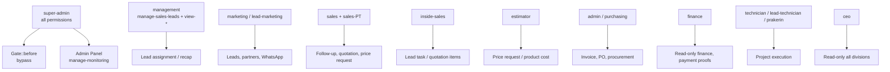

# Authorization Architecture

**Audit:** Phase 1 - CRM Application Architecture
**Repository:** `/var/www/3dyapp`
**Date:** 2026-11-23
**Mode:** Read-only inspection. No permissions were changed and no unauthorized request was made.

## 1. Authentication

### 1.1 Entry points

| Flow | Route | Controller | Notes |
|---|---|---|---|
| Email/password login | `GET/POST /login` | `Auth\AuthenticatedSessionController` | Rate limited per account and per IP (`LoginRequest.php:54-103`) |
| Google OAuth login/link | `GET /auth/google`, `/auth/google/callback` | `Auth\AuthenticatedSessionController` | Auto-provisions unknown Google accounts; no role assigned |
| Pending approval | `GET /pending-approval` | `Auth\AuthenticatedSessionController` | Users with no roles and no permissions are redirected here |
| Email verification | `/verify-email/*` | `Auth\EmailVerification*` | Dashboard requires `verified` |
| Password reset | `/forgot-password`, `/reset-password/*` | `Auth\PasswordResetLinkController`, `NewPasswordController` | Throttled 3/min |
| Logout | `POST /logout` | `Auth\AuthenticatedSessionController` | CSRF-protected |

### 1.2 Session and middleware

- Session driver: `database`.
- Web middleware: `SetLocale`, `SetSecurityHeaders`, `EnsureUserHasRole`, `InstantSaveResponse`, `FlashActionToast`, `PropagateWorkspaceEmbed` (`bootstrap/app.php:34-52`).
- `EnsureUserHasRole` is not a role gate. It isolates users with no roles and no permissions to the pending-approval screen (`app/Http/Middleware/EnsureUserHasRole.php:12-48`).
- `SetSecurityHeaders` sets `X-Content-Type-Options`, `X-Frame-Options`, `Referrer-Policy`, and `Permissions-Policy`, but deliberately omits Content-Security-Policy (`SetSecurityHeaders.php:1-30`).

### 1.3 Google auto-provisioning

Unknown Google accounts are created with `role = guest`, no Spatie role, and `email_verified_at = now()` (`AuthenticatedSessionController.php:128-139`). They are logged in but redirected to pending approval (`:164-169`).

**Observation:** There is no email-domain allowlist. Any Google account can create a pending user record. The record is inert until a super-admin assigns a role, but it can still consume user records and trigger super-admin notifications.

## 2. Role and Permission Model

The seeder creates **19 roles** and **25 permissions**.

### 2.1 Permission groups

| Group | Permissions |
|---|---|
| Division manage/view | `manage-marketing`, `view-marketing`, `manage-sales`, `view-sales`, `manage-admin`, `view-admin`, `manage-technician`, `view-technician`, `manage-monitoring`, `view-monitoring` |
| Shared read | `view-customer`, `view-trash`, `view-products` |
| Product write | `manage-products`, `manage-price-requests` |
| Monitoring | `monitor-marketing`, `monitor-technical` |
| Management hub | `manage-sales-leads` |
| Inside Sales | `manage-inside-sales` |
| Sensitive admin read | `view-admin-hub`, `view-supplier-pos`, `view-supplier-invoices`, `view-payment-proofs`, `view-goods-receipts`, `view-customer-finance` |

**Source:** `database/seeders/RoleAndPermissionSeeder.php:31-75`.

### 2.2 Role matrix

| Role | Key permissions | Scope / notes |
|---|---|---|
| `super-admin` | All permissions | `Gate::before` bypass; admin panel; cannot be deleted/edited through UI |
| `management` | `manage-sales-leads`, all `view-*`, `monitor-marketing`, `view-monitoring`, sensitive admin reads | Assign leads, read all divisions, no quotation write |
| `marketing` | `manage-marketing`, `view-marketing`, `view-customer`, `view-trash`, `view-products` | Lead intake, WhatsApp, partners |
| `lead-marketing` | `manage-marketing`, `view-marketing`, `monitor-marketing`, `view-technician` | Marketing lead + read-only technician docs |
| `sales` | `manage-sales`, `view-sales`, shared reads | Own leads; quotation via inside sales |
| `sales-nti`, `sales-mgk`, `sales-tps`, `sales-wani` | Same as `sales` | PT write scope through `PtAccess` |
| `inside-sales` | `manage-inside-sales`, shared reads | Task assignee only |
| `estimator` | `manage-price-requests`, `manage-products`, shared reads | Product cost requests |
| `admin` | `manage-admin`, `view-admin`, `view-sales`, all sensitive admin reads | Full admin/procurement/finance write |
| `purchasing` | `manage-admin`, `view-admin`, supplier/receipt/finance reads | No payment proof permission |
| `finance` | `view-admin`, supplier/receipt/payment-proof/finance reads | Read-only, no `manage-admin` |
| `technician` | `manage-technician`, `view-technician`, shared reads | Project execution |
| `lead-technician` | `manage-technician`, `view-technician`, `monitor-technical`, `view-sales`, `view-admin` | Coordination plus read-only sales/admin |
| `prakerin-technician` | `view-technician`, shared reads | Read-only technician |
| `prakerin-admin` | `view-admin`, shared reads | Read-only admin |
| `ceo` | All `view-*`, sensitive admin reads, no `manage-*` | Read-only across divisions |

**Source:** `RoleAndPermissionSeeder.php:77-155`.

### 2.3 Role map

## 3. Route-Level Authorization

- 83 inline `permission:` checks in `routes/web.php`.
- 0 `role:` route middleware usages.
- Permission expressions use `|` for OR semantics (Spatie `PermissionMiddleware`).
- The `role` middleware alias is registered in `bootstrap/app.php:30-34`, but routes do not use it.

**Pattern:** route groups define the coarse gate, and controllers/policies apply record-level checks. This is a valid pattern, but the two layers must stay aligned.

## 4. Policies and Gates

| Policy | Abilities | Notes |
|---|---|---|
| `LeadPolicy` | `viewAny`, `view`, `create`, `update`, `delete`, `restore`, `forceDelete` | Sales only own leads; inside sales only leads with an assigned task; technician/admin fallback |
| `CustomerPolicy` | `viewAny`, `view`, `create`, `update`, `delete`, `restore`, `forceDelete` | Uses `CustomerAccess` and `PtAccess` |
| `ProjectPolicy` | `viewAny`, `view`, `create`, `update`, `delete`, `restore`, `forceDelete` | Sales only own projects; technician/management/admin see all |
| `ProjectDocumentPolicy` | `view`, `upload`, `uploadVersion`, `update`, `archive`, `restore`, `forceDelete`, `viewAny` | Separates transaction, module, and general documents |
| `ProposalPolicy` | `viewCost`, `updateCost` | Financial fields only; no generic view/update |
| `PriceRequestPolicy` | `view`, `comment`, `review`, `assign`, `take`, `reject`, `reply`, `decide`, `cancel` | Strong participant-based rules |
| `ProductPolicy` | `viewCost`, `manageCost`, `manageSellingPrice` | Cost visibility and cost write separate |
| `EstimatorRequestPolicy` | `view`, `create`, `answer`, `decide`, `cancel`, `export` | Participant + management |
| `MonitoringPolicy` | `viewMonitoring`, `manageMonitoring` | Division monitoring |
| `ProjectStatusPolicy` | `manage` | `manage-monitoring` only |

**Gate::before:** only `super-admin` bypasses all ability checks (`AppServiceProvider.php:41`).

**Auto-discovery:** policies are not explicitly registered; Laravel discovers them by model/policy naming convention. This works for the ten policies above.

## 5. PT Scoping

### 5.1 `PtAccess`

- `isUnrestricted`: `super-admin`, `management`, or `manage-sales-leads` (`PtAccess.php:20-28`).
- `userPts`: parses roles matching `sales-<pt>` and checks against `Lead::PT_GROUPS` (`:31-50`).
- `canWritePt`: unrestricted, or no PT role, or null PT group returns true; otherwise PT must be in the user's list (`:62-74`).

**Important rule:** a user without a `sales-*` role is unrestricted. A user with one or more `sales-*` roles is limited to those PTs.

### 5.2 Where PT scoping is applied

| Area | Applied? | Evidence |
|---|---|---|
| Lead creation/update | Yes, writable PT list | `LeadController.php:161-164, 488` |
| Customer update/delete | Yes, policy + `PtAccess` | `CustomerPolicy.php:28-40` |
| Customer list query | Yes, restricted sales-like only | `CustomerAccess.php:50-100` |
| Price request create | Yes | `PriceRequestController.php:61` |
| Project document upload | Yes for sales | `ProjectDocumentController.php:68-75` |
| Document Center | Yes for sales-like | `DocumentCenterAccess.php:55-107` |
| Lead promote customer | **No** | `LeadController.php:970-984` |
| Lead status update | Owner check only | `LeadController.php:144-154` |

## 6. Customer Ownership

`CustomerAccess::canViewAll` returns true for super-admin, management, admin, marketing, technician, and CEO (`CustomerAccess.php:25-36`). Sales-like users are restricted to customers they:

- created,
- own through a lead,
- own through a quotation,
- own through a project,
- are assigned through an inside-sales task,
- created through a follow-up or POC.

Unowned legacy customers are visible to sales until claimed (`:62-88`).

**Observation:** Technicians and marketing see all customers by design. Sales see only their own scope. This matches the stated privacy requirement for sales, but it means `view-customer` alone is a broad read permission.

## 7. Document Access

### 7.1 Policy rules

`ProjectDocumentPolicy::view` (`:29-71`):

- Trashed documents use `DocumentAccess::canViewInTrash`.
- Transaction documents:
  - `payment` requires `view-payment-proofs`.
  - `invoice`/`po` require `view-admin` or `manage-admin`.
- General/technical documents:
  - any `view-customer`, or
  - any technician/sales permission.

`ProjectDocumentPolicy::upload` (`:74-94`): `manage-technician` or `manage-sales-leads`; sales can upload only survey documents for their own project.

`ProjectDocumentPolicy::update` (`:114-144`): transaction and module-owned documents cannot be edited through the generic route.

### 7.2 Trash rules

`DocumentAccess` distinguishes technical and transaction documents, applies role and PT scope, and handles payment-proof sensitivity even in the trash (`DocumentAccess.php:29-292`).

### 7.3 Document Center read model

`DocumentCenterAccess` mirrors route permissions rather than inventing broader ones (`DocumentCenterAccess.php:1-160`). It scopes sales by PT/owner and allows transaction types only with the matching admin permission.

## 8. Financial and Procurement Data

| Data | Write gate | Read gate |
|---|---|---|
| Customer invoice | `manage-admin` | `view-admin` / `manage-admin`; sales own invoice route |
| Customer payment | `manage-admin` | `view-admin` / `manage-admin`; proof requires `view-payment-proofs` |
| Customer PO | `manage-admin` (verify/return) | `view-admin` / `manage-admin` |
| Supplier PO | `manage-admin` | `view-supplier-pos` or `manage-admin` |
| Supplier invoice/payment | `manage-admin` | `view-supplier-invoices` or `manage-admin` |
| Goods receipt | `manage-admin` | `view-goods-receipts` or `manage-admin` |
| Goods delivery | `manage-admin` | `view-admin` / `manage-admin` |
| BAST | `manage-admin` (project), `manage-technician|manage-admin` (installation) | `view-technician`/`view-admin` variants |
| NPWP | customer update | `view-customer-finance` |
| Cost/margin | `manage-admin` (update cost) | `viewCost` policy |

**Strong points:** payment proof is separated from generic admin read; supplier data is separated from payment proof; transaction documents cannot be managed through the project-document route.

## 9. Authorization Findings

### AUTH-01 - `promoteCustomer` has no ownership or PT check

**Finding ID:** AUTH-01

- **Status:** Verified
- **Description:** Any user with `manage-sales` can promote any lead by ID; the controller checks permission only.
- **Evidence:** Route `routes/web.php:735-738`; controller `LeadController.php:970-984`.
- **Impact:** A salesperson can change another salesperson's lead customer from `lead` to `deal`, making it visible in the Customer menu. The mutation is logged, but it is unauthorized data change.
- **Severity:** Medium
- **Recommendation:** Add `$this->authorize('update', $lead)` and `PtAccess::canWritePt` before promotion. Add a negative test with a salesperson from another PT.

### AUTH-02 - Lead status route is broader than its controller guard

**Finding ID:** AUTH-02

- **Status:** Verified
- **Description:** The route allows `manage-technician` and `manage-admin`, but `authorizeLeadStatus` only allows marketing or the owning salesperson.
- **Evidence:** `routes/web.php:726-731`; `LeadController.php:144-154`.
- **Impact:** Admin/technician see a valid route but receive 403. This is safe but misleading, and it hides the real policy from route review.
- **Severity:** Low
- **Recommendation:** Either narrow the route gate or explicitly allow admin override. Keep one source of truth.

### AUTH-03 - Inside Sales cannot read quotations they created

**Finding ID:** AUTH-03

- **Status:** Verified
- **Description:** `InsideSalesQuotationController@store` sets `created_by` to the sales owner, while `ProposalController` authorizes only the creator or lead assignee (plus management/admin/technician/CEO). Inside Sales can reach the quotation list route but not the detail of its own draft.
- **Evidence:** `InsideSalesQuotationController.php:189-199`; `ProposalController.php:91-94, 160-172, 451-465`; route `routes/web.php:352-368`; sidebar Quotation link `sidebar.blade.php:34`.
- **Impact:** Inside Sales may see an empty quotation list or get 403 on a quotation it just generated. The workflow appears broken even though the data exists.
- **Severity:** Medium
- **Recommendation:** Include `lead_task_id`/`created_by` or task assignee in proposal view scope for `manage-inside-sales`, or redirect inside sales to the task quotation page. Add a positive access test.

### AUTH-04 - Project document upload policy allows management but the route does not

**Finding ID:** AUTH-04

- **Status:** Verified
- **Description:** `ProjectDocumentPolicy::upload` allows `manage-sales-leads`, but `project-documents.store` route allows only `manage-technician|manage-sales`.
- **Evidence:** `ProjectDocumentPolicy.php:74-94`; `routes/web.php:441-443`.
- **Impact:** Management is authorized by policy but blocked by route. This is more restrictive, not a security hole, but it creates dead capability and confusing tests.
- **Severity:** Low
- **Recommendation:** Align route and policy. If management should not upload, remove it from the policy; if it should, add it to the route.

### AUTH-05 - `hasRole('sales')` excludes users with only `sales-<pt>`

**Finding ID:** AUTH-05

- **Status:** Verified, latent
- **Description:** Several guards and dropdowns check only the base `sales` role, while the role model allows PT roles to be assigned independently.
- **Evidence:** `ManageSalesController.php:47, 74, 91, 153, 597`; `LeadController.php:174`; `SalesScheduleController.php:256`.
- **Impact:** A user with only `sales-nti` cannot be assigned leads, set targets, or appear in sales dropdowns. The seeded users currently hold both roles, so production may not expose the issue yet.
- **Severity:** Medium
- **Recommendation:** Add `User::isSales()` and use it consistently. Add a test user with only `sales-nti`.

### AUTH-06 - Cost/margin visibility conflicts with the security guidance

**Finding ID:** AUTH-06

- **Status:** Verified code, policy decision unclear
- **Description:** `ProposalPolicy::viewCost` grants cost/margin visibility to `manage-sales`, `manage-inside-sales`, `manage-sales-leads`, and CEO; `ProductPolicy::viewCost` also grants it to sales/inside sales. `AGENTS.md` lists margin/HPP as sensitive admin data.
- **Evidence:** `ProposalPolicy.php:25-35`; `ProductPolicy.php:15-24`; project security guidance in the `3dy-security` skill lists margin/HPP as sensitive admin data.
- **Impact:** Sales and inside sales can see cost and gross margin unless the UI hides it per page. This may be a deliberate commercial decision, but the documented security rule says otherwise.
- **Severity:** Medium
- **Recommendation:** Confirm the intended audience. If costs are sensitive, remove `manage-sales`/`manage-inside-sales` from `viewCost` and keep a separate `view_selling_margin` permission. If sales need margin to quote, update the security documentation.

### AUTH-07 - Role seeder wipes roles/permissions and hardcodes super-admin

**Finding ID:** AUTH-07

- **Status:** Verified
- **Description:** `RoleAndPermissionSeeder` deletes all roles, permissions, and pivots, recreates a fixed set, and assigns super-admin to a hardcoded email or user id 1.
- **Evidence:** `RoleAndPermissionSeeder.php:24-29, 77-155, 178-181`.
- **Impact:** Re-seeding destroys custom roles created in Admin Panel and manually assigned permissions. On a new database, another user with id 1 receives super-admin. This is a serious operational and security risk.
- **Severity:** High
- **Recommendation:** Make the seeder idempotent (`firstOrCreate` + explicit permission sync) and move super-admin bootstrap to a dedicated command. Add a production guard or confirmation.

### AUTH-08 - Role deletion has no assignment guard

**Finding ID:** AUTH-08

- **Status:** Verified
- **Description:** Admin Panel deletes any non-super-admin role without checking whether users still hold it.
- **Evidence:** `AdminPanelController.php:222-230`.
- **Impact:** Deleting a role silently removes access from every user who held it. There is no reassignment step or warning.
- **Severity:** Low
- **Recommendation:** Block deletion when the role has users, or require a reassignment target. Show the affected user count before deletion.

### AUTH-09 - Google OAuth has no domain allowlist

**Finding ID:** AUTH-09

- **Status:** Verified
- **Description:** Any Google account can auto-provision a pending user; there is no `hd`/domain check.
- **Evidence:** `AuthenticatedSessionController.php:106-149`.
- **Impact:** Unknown accounts can create user rows and notify super-admins. They cannot access data until a role is assigned.
- **Severity:** Low
- **Recommendation:** Restrict OAuth to company domains if Google Workspace is the intended identity source, or add an explicit signup approval policy.

### AUTH-10 - No Content-Security-Policy because of inline code

**Finding ID:** AUTH-10

- **Status:** Verified
- **Description:** Security headers omit CSP; the layout uses many inline scripts/styles and `@vite` assets.
- **Evidence:** `app/Http/Middleware/SetSecurityHeaders.php:1-30`; `resources/views/layouts/app.blade.php` contains multiple `<script>` and `<style>` blocks (for example lines 22-180, 285-500).
- **Impact:** If an XSS vector appears, CSP cannot reduce impact. Inline code also makes a future nonce migration harder.
- **Severity:** Medium
- **Recommendation:** Plan a nonce-based CSP after extracting inline scripts/styles. Do not enable enforcing CSP before the nonce work is complete.

## 10. Authorization Rules Recommended for Phase 2

1. Add a single `User::isSales()` helper and replace direct `sales` role checks.
2. Add ownership/PT checks to every lead mutation that currently checks permission only.
3. Align route gates with policies; add a test that every policy ability has a reachable route.
4. Include inside-sales task ownership in quotation view scope.
5. Confirm cost/margin visibility and update either code or the security standard.
6. Make the role seeder idempotent and remove hardcoded super-admin identity.
7. Add role-deletion guard and a user-count warning.
8. Add CSP only after inline script/style extraction; track it as a security hardening item, not a quick fix.
