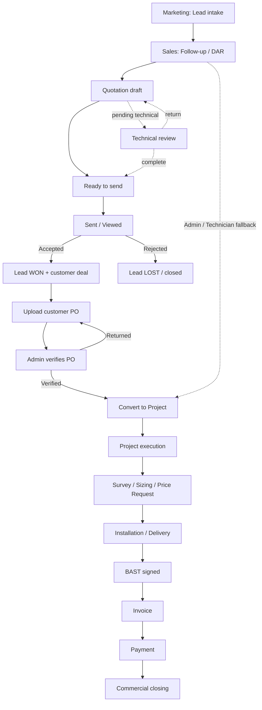

# Business Workflow Map

**Audit:** Phase 1 - CRM Application Architecture
**Repository:** `/var/www/3dyapp`
**Date:** 2026-11-23
**Mode:** Read-only inspection

## 1. Verified End-to-End Flow

The described chain exists, but not as a single enforced state machine. Each stage is implemented in a different module and the gates are distributed across controllers, models, and policies.

## 2. Stage Verification Table

| Stage | Exists? | Entry point | Main gate | Evidence |
|---|---|---|---|---|
| Marketing lead | Yes | `POST /leads`, WhatsApp convert | `manage-marketing` or `manage-sales`; customer status `lead` | `LeadController.php:473-604`; `WhatsAppCenterController.php:446-537` |
| Sales follow-up | Yes | `POST /sales/follow-ups` | Owner/creator; meeting/follow-up type rules | `FollowUpController.php:87-178`; `SalesService.php:123-182` |
| Quotation draft | Yes | `POST /sales/proposals` | Inside Sales/Management only; follow-up note required; one active quotation per lead | `ProposalController.php:523-642` |
| Technical review | Yes | `POST /sales/proposals/{id}/submit-technical` | Draft only; technical/admin completes or returns | `ProposalController.php:788-836` |
| Send quotation | Yes | `POST /sales/proposals/{id}/send` | Status `ready`; billable content required; owner only | `ProposalController.php:838-859` |
| Accept/reject | Yes | `POST /sales/proposals/{id}/respond` | Status `sent/viewed/revision/ready`; accepted requires billable content | `ProposalController.php:916-960` |
| Customer PO upload | Yes | `POST /sales/proposals/{id}/po` | Quotation accepted; at least one follow-up note; delivery address required | `ProposalController.php:973-1050` |
| PO verification | Yes | `POST /admin/purchasing/{proposal}/verify-po` | `manage-admin` or CEO; six PO fields complete | `PurchasingHandoffController.php:142-181`; `Proposal.php:251-274` |
| Return PO | Yes | `POST /admin/purchasing/{proposal}/return-po` | `manage-admin` or CEO; reason required | `PurchasingHandoffController.php:183-220` |
| Convert to project | Yes | `POST /sales/proposals/{proposal}/convert` | Accepted + PO file/number/payment scheme + not returned + verified | `ProposalController.php:1079-1170` |
| Direct lead to project | Yes, restricted | `PATCH /leads/{lead}/convert` | Marketing manager, owning sales, technician, or admin; no accepted quotation required for technician/admin | `LeadController.php:882-951` |
| Procurement | Yes | `/admin/supplier-pos`, `/admin/goods-*` | Supplier PO requires `isReadyForSupplierPo()` | `SupplierPurchaseOrderController.php:109`; `Proposal.php:243-248` |
| Survey | Yes | `/teknisi/surveys` | `manage-technician`; report required before completed | `SurveyController.php:71-150, 198-240` |
| Sizing | Yes | `/teknisi/sizing-projects` | `manage-technician`; attachment required before completed | `SizingProjectController.php:59-95, 119-160` |
| Installation | Yes | `/teknisi/instalasis` | `manage-technician`; report required before completed | `InstalasiController.php:150-220` |
| BAST project | Yes | `/admin/bast/{project}/edit` | `manage-admin`; both signature dates and document required for ready | `BastController.php:100-149`; `Project.php:207-228` |
| BAST installation | Yes | `PUT /teknisi/instalasis/{instalasi}/bast` | `manage-technician` or `manage-admin` | `InstalasiController.php:248-316` |
| Invoice | Yes | `/admin/invoices` | `manage-admin`; status cannot be manually paid | `AdminService.php:66-116, 456-500` |
| Payment | Yes | `/admin/payments` | `manage-admin`; cannot exceed remaining amount | `AdminController.php:394-429` |
| Commercial closing | Yes | Automatic after delivery/payment/BAST | Delivery delivered, procurement obligations met, BAST + progress/Done, all invoices paid | `Project.php:237-266` |

## 3. Business Rules by Stage

### 3.1 Lead intake

**Rules verified**

- A new lead with `customer_mode = new` always creates a customer with `status = lead` (`LeadController.php:517-528`).
- A salesperson without `manage-marketing` is forced to be the assignee (`LeadController.php:513-515`).
- Assignment target must have `sales` or `marketing` role (`LeadController.php:166-177`).
- `pt_group` must be in the user's writable PT list (`LeadController.php:161-164, 488`).
- Existing customers are resolved through `CustomerAccess::queryFor`, so a restricted salesperson cannot attach a lead to another salesperson's customer (`LeadController.php:543-545`).

**Rules not enforced**

- Lead intake is not wrapped in a database transaction. Customer, contact, lead, attachments, and activity are separate writes (`LeadController.php:517-578`). If attachment storage fails, a customer/lead may already exist.
- WhatsApp conversion repeats the same sequence without the same validation or transaction (`WhatsAppCenterController.php:465-537`).

### 3.2 Lead status transitions

`LeadPipelineService::assertCanTransition` enforces:

| Transition | Rule |
|---|---|
| Any -> `warm`, `hot`, `won` | At least one follow-up record must exist |
| Any -> `won` | An accepted quotation must exist |
| Any -> `lost` | A loss reason and a short note are required |
| `won` -> `won` | No-op, allowed |

**Evidence:** `app/Services/LeadPipelineService.php:16-53`.

**Additional behavior**

- `updateStatus` sets `acknowledged_at`, clears/sets `lost_reason`, and sets `closed_at` for `won`/`lost` (`LeadController.php:196-220`).
- `autoPromoteCustomer` promotes the customer to `deal` when the lead reaches `warm`, `hot`, or `won` (`LeadController.php:958-965`; `CustomerLifecycleService.php:22`).

### 3.3 Follow-up and meeting

- Follow-up statuses: `pending`, `process`, `completed` (`FollowUp.php:31`).
- `SalesService` handles creation, completion, reopen, snooze, next follow-up, and activity logging.
- `FollowUpController` limits update/complete/reopen/snooze to the creator unless the user has management permission (`FollowUpController.php:203-234, 246-304`).
- Meeting is a follow-up type; `SalesMeetingController` handles report creation.

**Risk:** follow-up and meeting status rules are split between controller and service. `SalesService::completeFollowUp` and `FollowUpController@complete` both need review when changing behavior.

### 3.4 Quotation lifecycle

**Status transitions**

| From | To | Guard |
|---|---|---|
| `draft` | `pending_technical` | Owner; draft only |
| `pending_technical` | `draft` | Technical/admin return |
| `pending_technical` | `ready` | Technical/admin complete; billable content required |
| `draft` | `ready` | Owner; billable content required |
| `ready` | `sent` | Owner; billable content required |
| `sent` | `viewed` | Owner; sent only |
| `sent`/`viewed` | `revision` | Owner; sent/viewed only |
| `sent`/`viewed`/`revision`/`ready` | `accepted`/`rejected` | Owner; accepted requires billable content |
| `draft`/`ready` | `cancelled` | Owner |

**Evidence:** `ProposalController.php:777-970`; `Proposal.php:12-14`.

**Other rules**

- One lead may have only one active quotation; revisions use the same number (`ProposalController.php:562-567`).
- Creating a quotation requires at least one follow-up record (`ProposalController.php:554-560`).
- Cost (`unit_cost`) tampering is blocked unless the user can `updateCost` (`ProposalController.php:293-305`).
- Price request can be linked to only one quotation (`ProposalController.php:471-475, 569-579`).
- PDF generation failure is non-fatal; the quotation is still saved (`ProposalController.php:634-638`).

### 3.5 Customer PO and verification

**Upload rules**

- Quotation must be `accepted` (`ProposalController.php:976`).
- At least one follow-up note must exist (`ProposalController.php:978-984`).
- Delivery address is required (`ProposalController.php:1001-1008`).
- PO file is required if no PO file exists yet (`ProposalController.php:989-994`).
- Uploading a new PO clears a previous return state (`ProposalController.php:1037-1041`).

**Verification rules**

- `manage-admin` or `ceo` only (`PurchasingHandoffController.php:144-145`).
- Quotation must be accepted and have a PO document (`PurchasingHandoffController.php:146`; `Proposal.php:234-237`).
- PO cannot be in returned state (`PurchasingHandoffController.php:147`).
- Completeness requires: PO document, PO number, PO date, delivery deadline, delivery address, payment scheme (`Proposal.php:251-274`).
- Verification writes `po_verified_at`/`po_verified_by`, clears return fields, logs a lead activity, and notifies the sales owner (`PurchasingHandoffController.php:156-180`).
- Return clears verification, stores reason, logs activity, and notifies sales (`PurchasingHandoffController.php:193-217`).

### 3.6 Project conversion

`ProposalController@convertToProject` requires:

1. Owner, `manage-admin`, `manage-sales-leads`, or `ceo`.
2. Quotation `accepted`.
3. No existing project for the quotation, including soft-deleted projects (`project()->exists()`).
4. Billable quotation content.
5. PO file, PO number, and payment scheme.
6. PO not returned.
7. PO verified.
8. Valid `work_type_id`, optional engineer/support, and engineer roles.

**Transaction:** project creation, support sync, procurement backfill, and lead activity are inside `DB::transaction` (`ProposalController.php:1113-1160`).

**After commit:** customer promotion, workflow sync, lead-technician notification, admin handoff notification.

**Gap:** `ProjectWorkflowService::sync` is called once immediately after creation, but not after BAST save.

### 3.7 Procurement

| Entity | Statuses | Transition guard |
|---|---|---|
| Supplier PO | `draft`, `ordered`, `partially_received`, `received`, `cancelled` | Issue only from `draft`; cancel from `draft`/`ordered` |
| Goods receipt | `draft`, `verified` | Verify only from `draft`; quantity cannot exceed remaining; serials required when applicable |
| Goods delivery | `prepared`, `shipped`, `delivered` | Cannot move back from `delivered` |
| Supplier invoice | `unpaid`, `partial`, `paid`, `cancelled` | Cannot pay cancelled; payment cannot exceed remaining |
| Supplier payment | n/a | Idempotency key supported |

**Evidence:** `SupplierPurchaseOrderController.php:205-217`; `GoodsReceiptController.php:134-158`; `GoodsDeliveryController.php:171-187`; `SupplierInvoiceController.php:168-178`; `SupplierPaymentController.php:26-70`.

**Invoice/payment:** customer invoice status is always derived from payments (`AdminService.php:456-500`). Manual creation allows only `unpaid` or `cancelled` (`AdminService.php:84-89`). Overpayment is blocked in the controller (`AdminController.php:414-419`). Invoice deletion is blocked when payments exist (`AdminService.php:225-238`).

### 3.8 Technician execution

- Survey: statuses `draft`, `scheduled`, `on_survey`, `completed`; report required before completed (`SurveyController.php:71-113, 205-232`).
- Sizing: statuses `draft`, `in_progress`, `waiting_approval`, `completed`; attachment required before completed (`SizingProjectController.php:59-83, 136-145`).
- Installation: statuses `scheduled`, `on_progress`, `waiting`, `completed`, `cancelled`; report required before completed (`InstalasiController.php:155-190`).
- `ProjectWorkflowService` marks a step done only when all records in that step are completed and have evidence:
  - Survey requires `status = completed` and report.
  - Sizing requires `status = completed` and non-empty attachments.
  - Installation requires `status = completed` and report.
  - Price request is done when all active requests are completed, or when no request exists but the project has a proposal.
  - BAST is done when `Project::isBastReady()`.

**Evidence:** `ProjectWorkflowService.php:36-160`.

### 3.9 BAST and commercial closing

**BAST ready** requires:

- `bast_document_id` filled.
- `bast_signed_3dy_at` filled.
- `bast_signed_customer_at` filled.

**Evidence:** `Project.php:207-212`.

**Commercial closing** requires:

1. Delivery: all goods deliveries delivered, or `requires_delivery = false`.
2. Procurement: all Supplier PO item quantities delivered, or no active Supplier PO.
3. Installation: `requires_installation = false`, or BAST number filled and progress >= 100 / status Done.
4. Invoice: at least one invoice exists and all non-cancelled invoices are paid.

**Evidence:** `Project.php:237-266`.

## 4. Workflow Findings

### WF-01 - Customer is promoted to `deal` at warm/hot, not only after a deal

**Finding ID:** WF-01

- **Status:** Verified behavior; business intent is a hypothesis
- **Description:** `CustomerLifecycleService::SERIOUS_STAGES` includes `warm`, `hot`, and `won`, and `LeadController@updateStatus` calls `autoPromoteCustomer` after every status change.
- **Evidence:** `CustomerLifecycleService.php:22-35`; `LeadController.php:222, 958-965`; `CustomerController.php:56-64`.
- **Impact:** A warm prospect becomes a `deal` customer and appears in the default Customer menu before a quotation or PO exists. This conflicts with the stated rule that a customer is a deal only after a commercial commitment.
- **Severity:** Medium
- **Recommendation:** Confirm with business. If promotion should happen at quotation accepted or PO verified, remove `warm`/`hot` from `SERIOUS_STAGES` and add a test for `CustomerController` default visibility.

### WF-02 - Admin/technician can create a project without a quotation

**Finding ID:** WF-02

- **Status:** Verified, documented exception
- **Description:** `LeadController@convert` allows `manage-technician` and `manage-admin` to create a project directly from a lead when there is no accepted quotation.
- **Evidence:** `LeadController.php:882-951` (allowed roles at 886-889; fallback at 909-914).
- **Impact:** The "one door" rule is not universal. A project can exist without `proposal_id`, `quotation_number`, or verified PO. This may be intended for legacy/manual projects, but it weakens reporting and commercial traceability.
- **Severity:** Medium (business control)
- **Recommendation:** Confirm the exception. If retained, require a reason/attachment and mark the project as `non_quotation` so reports can separate it.

### WF-03 - Project workflow requires survey and sizing even for projects that skip them

**Finding ID:** WF-03

- **Status:** Verified
- **Description:** `ProjectWorkflowService::evaluate` requires at least one survey and one sizing to mark those steps done. A delivery-only project or a project that starts directly at installation can never reach 100% progress.
- **Evidence:** `ProjectWorkflowService.php:44-110, 277-285`.
- **Impact:** Progress stays below 100%, status may remain `On Progress`, and the BAST/closing condition `progress >= 100 or status Done` may never be met automatically.
- **Severity:** High
- **Recommendation:** Make steps conditional on `WorkType` or project requirements (`requires_survey`, `requires_sizing`, `requires_installation`), or compute progress over applicable steps only. Add tests for delivery-only and installation-only projects.

### WF-04 - BAST save does not synchronize project workflow

**Finding ID:** WF-04

- **Status:** Verified
- **Description:** `BastController@update` updates BAST fields, calls `refreshBastReady`, notifies finance, and evaluates commercial closing, but never calls `ProjectWorkflowService::sync`. No scheduled workflow sync is registered.
- **Evidence:** `BastController.php:100-149`; `grep` found no `ProjectWorkflowService` reference in `BastController`; `projects:sync-workflow` exists but is not scheduled (`routes/console.php`).
- **Impact:** The BAST step and progress are not recalculated after BAST completion until another observer or a manual command runs. Commercial closing may be evaluated against stale progress.
- **Severity:** High
- **Recommendation:** Call `ProjectWorkflowService::sync($project)` after BAST update (inside the same flow) and after invoice/payment updates. Add a test that completes BAST and asserts progress/status.

### WF-05 - Manual project progress/status can override workflow

**Finding ID:** WF-05

- **Status:** Verified
- **Description:** `ProjectController@update` accepts `progress` and `project_status_id`; `ProjectService@update` writes them without checking workflow state or commercial closing.
- **Evidence:** `ProjectController.php:184-199`; `ProjectService.php:72-104`.
- **Impact:** A technician or manager can mark a project `Done` or `100%` while invoices are unpaid or BAST is incomplete. Reports and closing can disagree.
- **Severity:** Medium
- **Recommendation:** Either remove manual progress/status for active projects or require an override reason and log it. Ensure `commercial_closed_at` is the only source for closed reporting.

### WF-06 - Procurement can precede project conversion

**Finding ID:** WF-06

- **Status:** Verified, likely intentional
- **Description:** Supplier PO creation requires a quotation ready for supplier PO, not a project. `project_id` is nullable and backfilled on conversion.
- **Evidence:** `SupplierPurchaseOrderController.php:109-150`; `ProposalController.php:1120-1135`.
- **Impact:** Procurement can start early, but orphan procurement records can exist. Reports must handle `project_id = null`.
- **Severity:** Low
- **Recommendation:** Expose the orphan state in the procurement queue and add a reconciliation report. Do not block early procurement without a business decision.

### WF-07 - Lead intake is not transactional

**Finding ID:** WF-07

- **Status:** Verified
- **Description:** Customer, contact, lead, attachments, and activity are created in sequence without `DB::transaction` in `LeadController@store` and `WhatsAppCenterController@convert`.
- **Evidence:** `LeadController.php:517-578`; `WhatsAppCenterController.php:465-537`.
- **Impact:** A storage or database failure can leave a customer without a lead, or a lead without attachments/activity. Retrying can create duplicates.
- **Severity:** Medium
- **Recommendation:** Wrap each intake path in a transaction, including file storage compensation. Extract a shared `LeadIntakeService`.

### WF-08 - Survey/sizing/installation statuses are plain strings with local validation

**Finding ID:** WF-08

- **Status:** Verified
- **Description:** Survey has `STATUS_COMPLETED`, but sizing and installation use inline `in:` validation lists. There are no enum/constant definitions for sizing or installation statuses.
- **Evidence:** `SurveyController.php:213`; `SizingProjectController.php:71, 124`; `InstalasiController.php:79, 171`.
- **Impact:** Status labels and transition rules can drift between forms, filters, workflow evaluation, and reports.
- **Severity:** Low
- **Recommendation:** Add status constants or enums per module and reuse them in validation, filters, and workflow evaluation.
