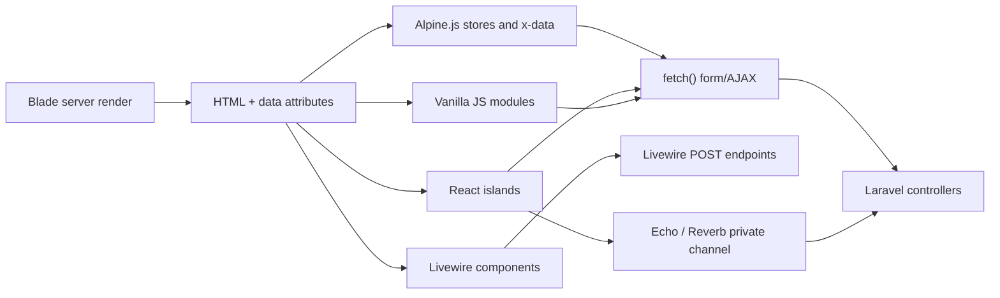

# Frontend Architecture

**Audit:** Phase 1 - CRM Application Architecture
**Repository:** `/var/www/3dyapp`
**Date:** 2026-11-23
**Mode:** Read-only inspection

## 1. Rendering Architecture

The frontend is not a single-page application. It is a server-rendered Blade application with four layers of client behavior:

**Counts**

| Item | Count |
|---|---:|
| Blade views | 310 |
| Blade components | 53 |
| Layouts | 4 (`app`, `embed`, `guest`, `auth`) |
| Livewire components | 3 |
| React entry islands | 3 (`notification-center.jsx`, `glide-select.jsx`, `rubber-segment.jsx`) |
| JS modules | 20 top-level `.js`/`.jsx` files plus 7 React component files |
| `x-data` usages | 108 |
| `x-show` usages | 341 |
| Native `<select>` elements | 184 |
| `<x-glide-select>` usages | 47 |
| `<table>` elements | 100 |
| `<x-data-table>` usages | 1 |
| Views containing inline `<script>` | 46 |
| `fetch()` calls inside views | 43 |
| `wire:navigate` usages | 99 |

## 2. Layouts

| Layout | Purpose | Size | Notes |
|---|---|---:|---|
| `layouts/app.blade.php` | Authenticated shell | 1,002 lines | Sidebar, header, workspace tabs, notification center, toast, confirm dialog, appearance bootstrap |
| `layouts/embed.blade.php` | Iframe content layout | 145 lines | No sidebar/header; used by workspace tabs |
| `layouts/guest.blade.php` | Guest shell | 60 lines | Minimal wrapper |
| `layouts/auth.blade.php` | Login/auth pages | 519 lines | Galaxy visual, auth card, theme bootstrap |

`app.blade.php` is a hybrid of layout, theme bootstrapper, inline CSS, inline JavaScript, and island configuration. It injects:

- `window.notifCenter` (initial notification page, unread count, unassigned count).
- `window.__workspaceConfig` (tabs enabled, max tabs, initial page).
- `window.vapidPublicKey` (Web Push).
- Appearance mode/accent from the authenticated user's preferences.
- Form error summary and validation strings.

**Assessment:** The layout is the real frontend application shell. Its size and inline code are the main maintainability and CSP constraints.

## 3. Blade Component Library

53 components exist. The most used:

| Component | Usages | Purpose |
|---|---:|---|
| `<x-icon-button>` | 569 | Standard icon-only/action button |
| `<x-back-button>` | 59 | Standard back navigation |
| `<x-glide-select>` | 47 | Custom select/dropdown |
| `<x-user-avatar>` | 38 | User avatar/initials |
| `<x-primary-button>` | 33 | Primary submit |
| `<x-secondary-button>` | 29 | Cancel/secondary |
| `<x-empty-state>` | 26 | Empty list state |
| `<x-flow-button>` | 14 | Primary CTA with flow animation |
| `<x-dropdown>` | 10 | Action menu |
| `<x-modal>` | 7 | Modal shell |
| `<x-confirm-dialog>` | 2 (layout + one page) | Global confirm dialog |
| `<x-donut-chart>` | 4 | Dashboard status ring |
| `<x-data-table>` | 1 | Generic table (almost unused) |

**Positive signal:** button and navigation standards are highly centralized. `x-icon-button` is used consistently across tables and headers.

**Inconsistency:** the generic `x-data-table` and `x-modal` components exist but most pages still hand-build tables and modals.

## 4. Livewire

Only three components exist:

| Component | Responsibility | View |
|---|---|---|
| `LeadTaskChat` | Task chat send/render | `resources/views/livewire/lead-task-chat.blade.php` |
| `PriceRequestChat` | Price request discussion | `resources/views/livewire/price-request-chat.blade.php` |
| `ProjectStatusList` | Admin panel project status CRUD | `resources/views/livewire/project-status-list.blade.php` |

They are small and focused. `LeadTaskChat` and `PriceRequestChat` dispatch browser events after send; `ProjectStatusList` dispatches `toast` events.

**Assessment:** Livewire is used as a targeted tool, not as the main UI framework. This is consistent with the Blade-first architecture.

## 5. Alpine.js

- 108 `x-data` usages, 341 `x-show` usages.
- Only two `Alpine.data` registrations in `app.js`: `counter` and the appearance store.
- Most page state is declared inline in Blade attributes.

**Strengths**

- Lightweight interactivity without a SPA build.
- Shared stores for appearance, confirm dialog, workspace tabs, and notification count.
- `x-cloak` is globally enforced in the layout.

**Weaknesses**

- Inline expressions are hard to test and reuse.
- Complex pages carry large `x-data` objects in HTML.
- Alpine state and React state coexist in the header (notification count is mirrored in `Alpine.store('notif')`).

## 6. React Islands

### 6.1 Notification Center

- Entry: `resources/js/notification-center.jsx` (44 lines).
- Main component: `resources/js/components/NotificationCenter.jsx` (993 lines).
- Child components: `NotificationToast.jsx`, `ToastViewport.jsx`.
- Data sources:
  - Initial JSON from `window.notifCenter`.
  - `GET /notifications/status` and `/notifications/feed`.
  - Echo private channel `notifications.{userId}`.
  - 60-second polling fallback and tab-focus refresh.

### 6.2 Glide Select

- Entry: `resources/js/glide-select.jsx` (160 lines).
- Mounts every `[data-glide-mount]` node, supports remount after dependent option changes.
- Used by 47 Blade usages, but 184 native selects remain.

### 6.3 Rubber Segment

- Entry: `resources/js/rubber-segment.jsx` (113 lines).
- Decorative segmented control for marketing range selection.
- Pure presentation, no server data.

### 6.4 Island mounting pattern

All three islands use the same pattern:

1. Query mount nodes.
2. Skip already-mounted nodes.
3. `createRoot(...).render(...)`.
4. Re-run on `livewire:navigated`.

This pattern is duplicated but consistent. A shared `mountIsland` helper would reduce repetition.

## 7. JavaScript Module Organization

Largest modules:

| Module | Lines | Responsibility |
|---|---:|---|
| `workspace-tabs.js` | 1,611 | Multi-tab iframe workspace, split view, persistence, unsaved guards |
| `doc-thumbs.js` | 888 | PDF/image thumbnails, lazy PDF.js worker |
| `form-validation.js` | 727 | Required-field messages, focus, error summary |
| `app.js` | 440 | Alpine bootstrap, appearance, Web Push, legacy AJAX forms, toast bridge |
| `galaxy.js` | 337 | Login starfield visual |
| `workspace-embed.js` | 280 | Embed mode propagation and iframe coordination |
| `confirm-dialog.js` | 257 | Global confirm interceptor and Alpine store |
| `bulk-price-update.js` | 253 | Bulk price editor |
| `instant-save.js` | 218 | AJAX submit with early toast |
| `notification-center.jsx` | 44 | React island entry |

**Assessment:** The JS is organized by feature, not by framework. `workspace-tabs.js` and `doc-thumbs.js` are large but cohesive. `app.js` mixes unrelated concerns (appearance, push, legacy AJAX, toast, sidebar).

## 8. Frontend Data Flow

### 8.1 Standard form submit

1. Blade form posts to a controller.
2. Controller redirects with `success`/`warning`/`error`.
3. `FlashActionToast` adds a message if the controller did not.
4. Layout renders the message into the toast queue.
5. React `ToastViewport` renders the card.

### 8.2 Instant save

1. Form is eligible when `data-instant-save="1"` is on `<html>`.
2. `instant-save.js` intercepts submit, marks the form busy, sends `fetch` with `Accept: application/json`.
3. `InstantSaveResponse` converts redirect + flash into JSON.
4. Toast appears before navigation; then the browser follows `redirect`.

### 8.3 AJAX filters

1. Form has `data-ajax`.
2. `app.js` sends a GET request, replaces the target HTML, and pushes state.
3. A skeleton table is shown while loading.
4. 422 responses show inline errors or a toast.

### 8.4 Confirmation

- Any form/link with `data-confirm` is intercepted by `confirm-dialog.js`.
- The global `<x-confirm-dialog>` Alpine store renders the modal.
- Approval re-submits with `data-confirm-bypass="1"`.

### 8.5 Notifications

1. Server creates a database notification.
2. `DatabaseNotification` dispatches `NotificationCreated`.
3. Event broadcasts on `notifications.{userId}` via Reverb.
4. React island updates the bell, feed, unread count, and toast.
5. If Reverb is unavailable, the island polls every 60 seconds.

### 8.6 Workspace tabs

- `workspace-tabs.js` stores tab state per user in `localStorage`.
- Each tab is an iframe with `?embed=1`.
- Max tabs: 8 desktop, 6 mobile (`config/workspace.php`).
- `workspace-embed.js` keeps embed mode across redirects.
- `workspace-frame-guard.blade.php` prevents nested iframes.

## 9. Theme, Responsive, and Accessibility

### Theme

- Server preference (`users.preferences`) is the source of truth.
- `data-mode` (light/dark/system) and `data-theme` (accent) are rendered on `<html>`.
- `app.js` applies the theme before first paint and on `livewire:navigated`.
- LocalStorage theme keys are deliberately removed; the old global browser preference is no longer used.

### Responsive

- Sidebar collapses to a rail on desktop and off-canvas on mobile.
- Workspace tabs have separate desktop/mobile limits.
- Most grids use responsive Tailwind classes, but a full mobile audit was not performed in this phase.

### Motion

- Toast, sidebar, and workspace transitions respect `prefers-reduced-motion` in several modules.
- A full reduced-motion audit across 310 views was not performed.

### Accessibility

- Icon-only buttons usually have `title`/`aria-label` via `x-icon-button`.
- Confirmation modal focuses the cancel button and traps Tab (per `confirm-dialog.js`).
- A complete keyboard and contrast audit is a Phase 2 task.

## 10. Frontend Findings

### FE-01 - Native selects still dominate the UI

**Finding ID:** FE-01

- **Status:** Verified
- **Description:** 184 native `<select>` elements remain, while only 47 `<x-glide-select>` usages exist.
- **Evidence:** `grep` counts across `resources/views`; component at `resources/views/components/glide-select.blade.php`.
- **Impact:** Dropdown look, keyboard behavior, and dark-mode styling are inconsistent. The project standard says native selects must be migrated as files are touched.
- **Severity:** Medium (UI consistency)
- **Recommendation:** Migrate per touched file, not in a mass rewrite. Add a lint rule/test that fails new native selects in new views.

### FE-02 - Inline scripts and fetch calls in Blade views

**Finding ID:** FE-02

- **Status:** Verified
- **Description:** 46 Blade files contain inline `<script>` blocks and 43 `fetch()` calls live directly in views.
- **Evidence:** `grep -rl '<script' resources/views | wc -l` = 46; `grep -rho 'fetch(' resources/views | wc -l` = 43.
- **Impact:** Page logic is split between views and JS modules. It is hard to test and blocks CSP adoption.
- **Severity:** Medium
- **Recommendation:** Move page-specific fetch logic into feature modules under `resources/js`, keeping only serialized config in Blade.

### FE-03 - Table markup is duplicated

**Finding ID:** FE-03

- **Status:** Verified
- **Description:** 100 `<table>` elements exist, but `<x-data-table>` is used once.
- **Evidence:** `grep` counts; `resources/views/components/data-table.blade.php`.
- **Impact:** Pagination, empty states, responsive wrappers, and action columns are reimplemented per page.
- **Severity:** Medium
- **Recommendation:** Do not force one table component on every page. Extract shared table header/empty-state/pagination partials where the next table is touched.

### FE-04 - Modal markup is duplicated

**Finding ID:** FE-04

- **Status:** Verified
- **Description:** 33 `fixed inset-0` modal patterns exist, but `<x-modal>` is used only 7 times.
- **Evidence:** `grep -rho 'fixed inset-0' resources/views | wc -l` = 33; `<x-modal>` = 7.
- **Impact:** Focus trapping, Escape handling, and dark-mode styling vary by page.
- **Severity:** Medium
- **Recommendation:** Standardize new modals on `<x-modal>` and migrate existing ones when touched.

### FE-05 - Typography standard is widely violated

**Finding ID:** FE-05

- **Status:** Verified
- **Description:** 80 `text-[10px]` and 190 `text-[11px]` occurrences remain, below the 12px minimum in `AGENTS.md` §7.5.
- **Evidence:** `grep` counts; example `resources/views/layouts/partials/sidebar.blade.php:92, 138, 552`.
- **Impact:** Small labels are hard to read, especially on low-DPI screens and in dark mode.
- **Severity:** Medium (accessibility)
- **Recommendation:** Replace with `text-xs` (12px) when touching a file. Do not perform a blind mass replace without visual review.

### FE-06 - Workspace tabs is a large custom runtime

**Finding ID:** FE-06

- **Status:** Verified
- **Description:** `workspace-tabs.js` is 1,611 lines and manages iframes, split view, persistence, unsaved guards, and cross-frame events.
- **Evidence:** `resources/js/workspace-tabs.js`; `config/workspace.php`; `layouts/embed.blade.php`.
- **Impact:** Bugs in this module affect every page. It is difficult to test without a browser.
- **Severity:** Medium
- **Recommendation:** Add browser-level tests for tab open/close, max limit, unsaved guard, and iframe reload. Do not rewrite unless a concrete defect appears.

### FE-07 - Stale comment says navigation is full page reload

**Finding ID:** FE-07

- **Status:** Verified
- **Description:** `app.blade.php` contains a comment stating Livewire JS is not loaded and navigation is a full page reload, but the layout loads `@livewireScripts` (line 1000), uses `wire:navigate` 99 times, and listens to `livewire:navigated`.
- **Evidence:** `resources/views/layouts/app.blade.php:255-267` (comment) vs `:1000` (`@livewireScripts`) and `resources/views` (`wire:navigate` count 99).
- **Impact:** The comment can mislead future work on animations and state persistence.
- **Severity:** Low
- **Recommendation:** Correct the comment when the layout is next touched.

### FE-08 - CSP is blocked by inline scripts and styles

**Finding ID:** FE-08

- **Status:** Verified
- **Description:** The layout contains multiple inline scripts and a large inline `<style>` block; 46 views add more inline scripts.
- **Evidence:** `resources/views/layouts/app.blade.php` inline blocks; `SetSecurityHeaders.php` deliberately omits CSP.
- **Impact:** XSS impact cannot be reduced with CSP. A nonce migration is a prerequisite.
- **Severity:** Medium
- **Recommendation:** Extract inline bootstrapping and page scripts into Vite modules, then introduce a nonce-based CSP. Track as a security hardening project.

### FE-09 - `app.js` mixes unrelated global concerns

**Finding ID:** FE-09

- **Status:** Verified
- **Description:** `app.js` handles Alpine bootstrap, appearance, Web Push, legacy AJAX forms, toast bridge, sidebar groups, and login galaxy.
- **Evidence:** `resources/js/app.js:1-440`.
- **Impact:** Changes to one concern risk breaking another. The file is loaded on every page.
- **Severity:** Low
- **Recommendation:** Split appearance, Web Push, and legacy AJAX into modules imported by `app.js`. Keep the public `window.toast`/`window.WebPush` API stable.

### FE-10 - Alpine state is mostly inline

**Finding ID:** FE-10

- **Status:** Verified
- **Description:** 108 `x-data` usages, but only two `Alpine.data` registrations.
- **Evidence:** `resources/js/app.js` (`Alpine.data('counter')`, appearance store); Blade `x-data` count.
- **Impact:** Reusable state logic is duplicated in HTML and hard to unit test.
- **Severity:** Low
- **Recommendation:** Extract repeated page behaviors into named `Alpine.data` components when a page is next modified.

## 11. Frontend Strengths

- Button, back navigation, and empty-state components are widely adopted.
- Toast and confirm dialog are centralized and use one visual system.
- Notification center has realtime plus polling fallback.
- Theme preference is server-owned, avoiding cross-account theme leakage.
- Workspace tabs respect reduced motion and use an embed layout to avoid nested shells.
- PDF thumbnails load PDF.js lazily, keeping first paint lighter.

## 12. Phase 2 Frontend Checks

1. Mobile and dark-mode pass on the five largest modules.
2. Keyboard and focus audit for modals, dropdowns, and tables.
3. Contrast audit on token-based text.
4. Browser tests for workspace tabs and notification realtime.
5. CSP nonce migration plan.
6. Native select and modal migration plan, file by file.
