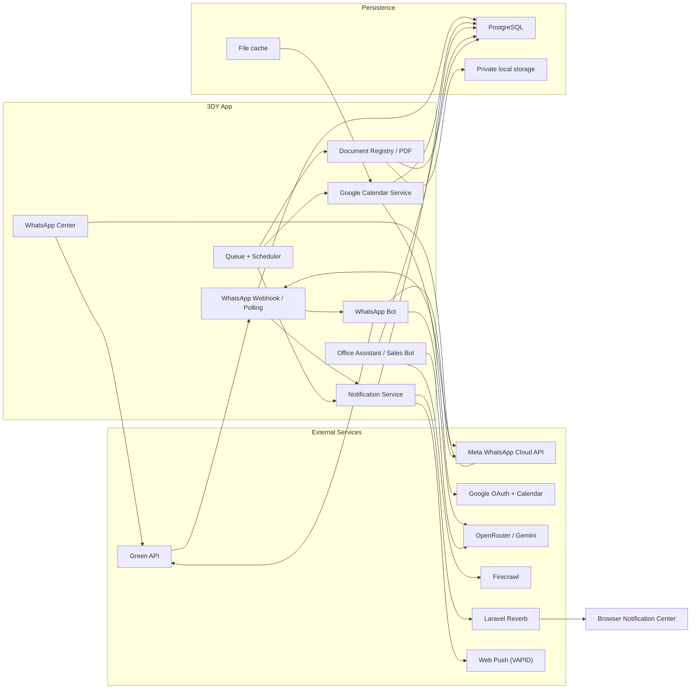
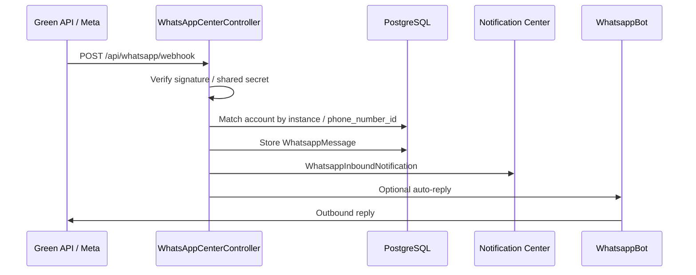

# Integration Architecture

**Audit:** Phase 1 - CRM Application Architecture
**Repository:** `/var/www/3dyapp`
**Date:** 2026-11-23
**Mode:** Read-only inspection. No external API was called and no credential was printed.

## 1. Integration Map

## 2. WhatsApp Integration

### 2.1 Supported gateways

- Green API (default).
- Meta WhatsApp Business Cloud API.
- Per-account credentials in `whatsapp_accounts` (`gateway_type`, `gateway_instance`, `gateway_token`).
- Config: `config/whatsapp.php`.

### 2.2 Inbound flow

**Verified rules**

- Meta payload uses `X-Hub-Signature-256` HMAC with app secret; empty secret rejects (`WhatsAppCenterController.php:585-600`).
- Green API uses an `Authorization` header token; empty secret rejects (`:619-654`).
- Legacy payloads are rejected (`:576-577`).
- Unknown account/phone number id returns 422 (`:655-726`).
- Inbound message storage is idempotent by `wa_message_id` for Meta (`:726-762`).

### 2.3 Outbound flow

- `WhatsAppCenterController@store` sends text through `WhatsappGateway::sendText`.
- Gateway chooses Green API or Meta based on `gateway_type`.
- Outbound status callbacks update `WhatsappMessage.status`.
- Bot replies use `WhatsappSalesBot` via OpenRouter, with a fallback reply on failure (`WhatsappBot.php:262-279`).

### 2.4 Polling fallback

- `whatsapp:receive` runs every 30 seconds from `bootstrap/app.php`.
- It processes up to 50 notifications per account per run (`ReceiveWhatsappMessages.php:16-50`).
- Only non-Meta accounts are polled; Meta uses webhooks.

### 2.5 Conversion to lead

- `WhatsAppCenterController@convert` creates customer, contact, lead, activity, links prior messages, and notifies management.
- It does not call `LeadPipelineService` or `LeadController@store`.
- Customer status defaults to `lead` from the migration.

## 3. Google Calendar Integration

### 3.1 Flow

1. Technician connects Google via OAuth from the calendar page.
2. `GoogleCalendarService` stores credentials and calendar id per user/app.
3. `syncTwoWay()` pulls Google events and pushes local schedule changes.
4. Sync is triggered by:
   - `gcal:sync` scheduled every 5 minutes.
   - `SyncGoogleCalendarJob` after local schedule changes.
   - manual "Sync now" button.

### 3.2 Safeguards

- `Cache::lock('gcal:sync', 300)` prevents concurrent sync (`GoogleCalendarService.php:407-416`).
- Pull window is 30 days back and 2 months forward (`:237-243`).
- Local changes are limited to 100 pending schedules per push (`:381-384`).
- API calls use retry logic (`:198-235`).
- Sync errors are classified and logged; scheduler does not fail the whole run (`SyncGoogleCalendar.php:16-45`).

### 3.3 Ownership fallback

When importing an event without a known local owner, `syncFromGoogle` picks the first user with `manage-technician` or `manage-admin`, otherwise the first user in the table (`:247-250`).

**Risk:** Imported events may be attributed to an arbitrary user if the event lacks a matching local schedule.

## 4. Realtime Notifications (Reverb)

### 4.1 Server side

- `DatabaseNotification` fires `NotificationCreated` on create (`app/Models/DatabaseNotification.php:17-22`).
- Event uses `ShouldBroadcastNow` and `ShouldRescue` (`NotificationCreated.php:22`).
- Broadcast channel: private `notifications.{userId}`.
- Channel authorization compares the authenticated user id (`routes/channels.php:6-8`).
- Payload: presented notification item plus unread count (`NotificationCreated.php:44-56`).

### 4.2 Client side

- `echo.js` lazily imports `laravel-echo` and `pusher-js`, using `VITE_REVERB_*`.
- If the Reverb key is missing, it returns null and the React island falls back to polling.
- React `NotificationCenter` subscribes to the private channel and also polls every 60 seconds and on tab focus (`NotificationCenter.jsx:456-600`).

### 4.3 Why `ShouldBroadcastNow`

The code comment says the queue is cron-driven, so queued broadcast could be delayed up to 60 seconds. `ShouldRescue` prevents a Reverb outage from failing the request.

## 5. Web Push

- Package: `laravel-notification-channels/webpush` 13.0.1.
- VAPID keys from `.env` (`VAPID_PUBLIC_KEY`, `VAPID_PRIVATE_KEY`).
- Package config is merged by the service provider; no local `config/webpush.php` is required.
- `PushSubscriptionController` stores/deletes subscriptions for the authenticated user.
- `SendsWebPush` trait adds the Web Push channel when `notify_push` is enabled.
- Service worker: `public/sw.js`.
- Browser API: `window.WebPush` in `app.js` (`status`, `enable`, `disable`).

**Notification channels:** database, mail, and Web Push are independent preferences. Turning off email does not turn off in-app or push (`SendsWebPush.php:1-40`).

## 6. AI Assistant

### 6.1 Components

- `OfficeAssistant` agent: OpenRouter provider, temperature 0.3, max 2048 tokens.
- `WhatsappSalesBot` agent: OpenRouter, Gemini 2.5 Flash, temperature 0.4.
- Tools: `GetMyTasks`, `GetLatestProjects`, `GetLeadDetails`, `GetProjectDetails`, `GetProjectProgress`, `GetSalesSummary`, `GetProductKnowledge`.
- Knowledge base: Laravel AI file search store (`config/ai.php:162-164`).
- Product knowledge: Firecrawl scrape + extraction + chunking + admin publish workflow.

### 6.2 Data access

- AI tools are read-only.
- `GetLeadDetails` restricts sales to their own leads (`app/Ai/Tools/GetLeadDetails.php:22-39`).
- `GetSalesSummary` requires `view-monitoring` or `view-admin` (`GetSalesSummary.php:25-29`).
- Tools return "access denied" text instead of throwing, so the model can explain the limitation.

### 6.3 Product knowledge pipeline

1. Admin submits up to 50 public URLs (`config/knowledge.php`).
2. `PublicUrl` rule blocks localhost, private ranges, and cloud metadata IPs (`app/Rules/PublicUrl.php`).
3. `ImportProductSource` job scrapes via Firecrawl.
4. `PollProductCrawl` job polls crawl status up to 20 times with a 2-minute delay (`PollProductCrawl.php:26-46`).
5. `ProductKnowledgePipeline` matches/creates products, stores documents, chunks content, and marks review state.
6. Admin publishes or rejects products.

## 7. Document Processing

### 7.1 PDF generation

- Quotation PDF uses `barryvdh/laravel-dompdf` (`QuotationPdfService.php:14-24`).
- PDF generation runs synchronously during quotation create/update (`ProposalController.php:634-638, 767-771`).
- Failure is reported but does not block the quotation.

### 7.2 Document registry

- `DocumentRegistry` keeps one row per file for Survey, Sizing, and Installation.
- `sync()` updates/creates rows and force-deletes stale rows not in the current file list (`DocumentRegistry.php:57-84`).
- `forget()` removes rows when the owning module record is deleted (`:90-...`).
- `AdminService` and `BastController` also create transaction/BAST documents in `project_documents`.

### 7.3 Secure file handling

- `SecureFile` rejects dangerous extensions and validates MIME from file content (`app/Rules/SecureFile.php:16-90`).
- Files are stored on the `private` disk; downloads use `SecureFile::fileResponse` or `Storage::download`.
- Document thumbnails use PDF.js in `doc-thumbs.js` with a lazily loaded worker (`vite.config.js:10-28`).

### 7.4 Document Center

- `DocumentCenterService` unions eight sources.
- It is a read model; files are not copied.
- Access is scoped by `DocumentCenterAccess`.

## 8. Queue and Scheduled Work

### 8.1 Queue

- Driver: `database`.
- Worker: `queue:work --stop-when-empty --max-time=50` every minute from the scheduler.
- Jobs: `ImportProductSource`, `PollProductCrawl`, `SyncGoogleCalendarJob`.
- Queued notifications: 11 of 36 notification classes implement `ShouldQueue`.

### 8.2 Schedule

| Command | Frequency | Source |
|---|---|---|
| `whatsapp:receive` | every 30 seconds | `bootstrap/app.php` |
| `whatsapp:bot` | every 30 seconds | `bootstrap/app.php` |
| `schedules:remind` | every minute | `routes/console.php` |
| `followups:remind` | daily | `routes/console.php` |
| `leads:overdue` | hourly | `routes/console.php` |
| `meetings:remind` | daily 17:00 | `routes/console.php` |
| `proposals:expire` | daily 01:30 | `routes/console.php` |
| `documents:purge-trash` | hourly | `routes/console.php` |
| `gcal:sync` | every 5 minutes, no overlap | `routes/console.php` |
| `queue:work` | every minute | `routes/console.php` |

**Not scheduled:** `projects:sync-workflow`, `knowledge-base:*`, `customers:backfill-contacts`, `documents:sync-modules`, `files:migrate-private`.

## 9. Failure Modes and Observability

| Integration | Failure behavior | Evidence |
|---|---|---|
| WhatsApp webhook | Rejects invalid/unknown payload; logs unknown Meta phone id | `WhatsAppCenterController.php:585-726` |
| WhatsApp polling | Processes up to 50 per account; logs summary | `ReceiveWhatsappMessages.php:16-50` |
| WhatsApp bot | Returns fallback reply on LLM failure | `WhatsappBot.php:270-278` |
| Google Calendar | Locked, retried, classified, logged; scheduler continues | `GoogleCalendarService.php:407-430`; `SyncGoogleCalendar.php` |
| Reverb | `ShouldRescue` prevents request failure; frontend polls | `NotificationCreated.php:22`; `NotificationCenter.jsx:592-600` |
| Web Push | No notification if permission denied or no subscription | `app.js` `window.WebPush` |
| Firecrawl | Job retries crawl up to 20 times; source marked failed | `PollProductCrawl.php:26-46` |
| PDF generation | Caught/reported; quotation still saved | `ProposalController.php:634-638` |
| Queue | Failed jobs depend on standard Laravel failed-job handling; no custom alerting found | `config/queue.php` |

## 10. Integration Findings

### INT-01 - Meta secret documentation contradicts fail-closed behavior

**Finding ID:** INT-01

- **Status:** Verified
- **Description:** `config/whatsapp.php` says an empty Meta app secret means verification is skipped in dev/test, but the controller rejects when the secret is empty.
- **Evidence:** `config/whatsapp.php:55-57`; `WhatsAppCenterController.php:585-600`.
- **Impact:** A developer following the config comment may expect unsigned local webhooks to work and get 403 instead. The code is safer than the comment.
- **Severity:** Low
- **Recommendation:** Update the comment to state fail-closed behavior. Do not weaken the controller.

### INT-02 - AI tool authorization is separate from policies

**Finding ID:** INT-02

- **Status:** Verified
- **Description:** AI tools implement their own permission checks instead of using `Gate`/policies. For example, `GetSalesSummary` checks `view-monitoring|view-admin`, and `GetLeadDetails` checks marketing/sales permissions and own-lead scope.
- **Evidence:** `app/Ai/Tools/GetLeadDetails.php:22-39`; `GetSalesSummary.php:25-29`.
- **Impact:** A future policy change will not automatically apply to AI answers. A tool can expose data that the corresponding UI route would hide.
- **Severity:** Medium
- **Recommendation:** Make tools call the same policies/services used by controllers, or add contract tests comparing tool output with policy decisions for each role.

### INT-03 - Queue processing depends on the scheduler

**Finding ID:** INT-03

- **Status:** Verified
- **Description:** The queue worker is invoked by the scheduler every minute with a 50-second runtime limit. There is no supervised worker in the repository configuration.
- **Evidence:** `routes/console.php` (queue:work line); `composer.json` `dev` script includes a queue listener for local development only.
- **Impact:** If cron is not running or the scheduler is paused, queued notifications, imports, and calendar sync stop. Short workers can also leave jobs until the next minute.
- **Severity:** Medium
- **Recommendation:** Run a supervised `queue:work` process in production and keep the scheduler for scheduled commands only. Add a health check for the last successful queue run.

### INT-04 - Google Calendar import can assign events to an arbitrary user

**Finding ID:** INT-04

- **Status:** Verified
- **Description:** When no local owner is found, the service picks the first user with `manage-technician`/`manage-admin`, otherwise the first user in the table.
- **Evidence:** `GoogleCalendarService.php:247-250`.
- **Impact:** Imported events may appear under the wrong technician, affecting schedules and reminders.
- **Severity:** Low
- **Recommendation:** Require a calendar-to-user mapping or leave unmapped events unassigned with a review flag. Do not silently choose the first user.

### INT-05 - WhatsApp conversion bypasses lead workflow rules

**Finding ID:** INT-05

- **Status:** Verified
- **Description:** WhatsApp conversion creates a lead directly, without the follow-up/assignment/PT guards used by `LeadController@store`.
- **Evidence:** `WhatsAppCenterController.php:446-537`; compare `LeadController.php:473-604`.
- **Impact:** WhatsApp leads have different data quality and may skip assignment rules. This is the same duplication described in MOD-03 and WF-07.
- **Severity:** Medium
- **Recommendation:** Use a shared lead intake service and add the WhatsApp-specific fields as options.

### INT-06 - Quotation PDF generation is synchronous

**Finding ID:** INT-06

- **Status:** Verified
- **Description:** Dompdf generates the quotation PDF during the create/update request.
- **Evidence:** `QuotationPdfService.php:14-24`; `ProposalController.php:634-638, 767-771`.
- **Impact:** Large quotations or slow storage can increase response time. The failure is non-fatal, but the user may wait for a PDF that is not needed immediately.
- **Severity:** Low
- **Recommendation:** Consider queuing PDF generation after the transaction, with a "PDF generating" state. Do not change until response time is measured.

### INT-07 - Scheduler definitions are split across two files

**Finding ID:** INT-07

- **Status:** Verified
- **Description:** WhatsApp polling is scheduled in `bootstrap/app.php`; all other commands are in `routes/console.php`.
- **Evidence:** `bootstrap/app.php:106-113`; `routes/console.php`.
- **Impact:** Operators and reviewers must check two files to understand scheduled work.
- **Severity:** Low
- **Recommendation:** Move all scheduling into `routes/console.php` or a dedicated `routes/schedule.php` when the scheduler is next changed.

### INT-08 - Reverb broadcast is synchronous by design

**Finding ID:** INT-08

- **Status:** Verified
- **Description:** `NotificationCreated` uses `ShouldBroadcastNow`, so broadcast runs in the web request; `ShouldRescue` prevents a Reverb outage from failing the request.
- **Evidence:** `NotificationCreated.php:8-22`.
- **Impact:** Extra latency on every notification creation when Reverb is slow; no failure if Reverb is down.
- **Severity:** Info
- **Recommendation:** Keep the current behavior while the queue is cron-driven. Revisit if notification volume grows.

## 11. Integration Strengths

- Webhook verification is fail-closed for both providers.
- Green API polling provides a fallback when a public webhook is unavailable.
- Google Calendar sync has a distributed lock and retry/error classification.
- Reverb has a polling fallback, so the bell still works without WebSocket.
- Web Push preferences are independent from email and in-app notifications.
- Public URL validation blocks SSRF for Firecrawl imports.
- Secure file validation checks extension and content MIME.
- Document thumbnails are lazy-loaded to protect first paint.

## 12. Integration Checks for Phase 2

1. Verify production cron and queue supervisor health.
2. Test WhatsApp webhook with both providers using signed payloads in a staging environment.
3. Confirm Google Calendar owner mapping for imported events.
4. Audit AI tools against policies for every role.
5. Measure quotation PDF response time for large quotations.
6. Confirm failed job alerting and retention.
7. Verify `projects:sync-workflow` is either scheduled or replaced by event-driven sync.
