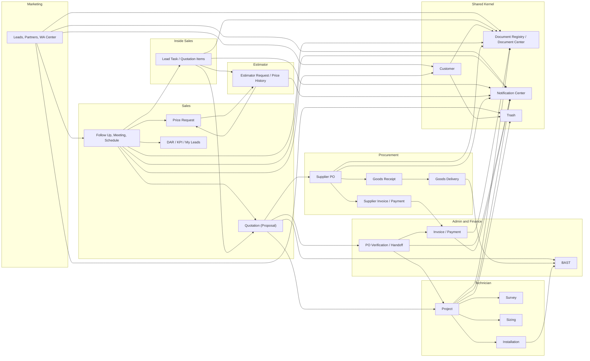

# Module Dependency Map

**Audit:** Phase 1 - CRM Application Architecture
**Repository:** `/var/www/3dyapp`
**Date:** 2026-11-23
**Mode:** Read-only inspection

## 1. Dependency Diagram

## 2. Dependency Table

| From | To | Mechanism | Evidence |
|---|---|---|---|
| Marketing | Customer | Creates `Customer` with status `lead` | `LeadController.php:517-528` |
| Marketing | Sales | Assigns leads; pipeline visibility | `ManageSalesController.php:144-175` |
| Marketing | WhatsApp | `WhatsappGateway`, `WhatsappBot`, webhook | `WhatsAppCenterController.php:558-654` |
| Sales | Customer | Customer access scope, follow-up, promotion | `CustomerAccess.php:50-100` |
| Sales | Quotation | `Proposal`, `ProposalItem`, versions | `ProposalController.php` |
| Sales | Inside Sales | `LeadTask` requests and items | `routes/web.php:868-899` |
| Sales | Estimator | `EstimatorRequest`, `PriceRequest` | `routes/web.php:274-321` |
| Inside Sales | Quotation | Creates draft `Proposal` from task | `InsideSalesQuotationController.php:154-260`; `LeadTaskController.php:670-781` |
| Estimator | Product | Cost and price logs | `EstimatorRequestController`; `ProductPriceLog` |
| Sales / Admin | Customer PO | `Proposal.po_*` fields | `PurchasingHandoffController.php:142-220` |
| Admin | Project | Convert accepted quotation | `ProposalController.php:1079-1170` |
| Admin | Procurement | Supplier PO, receipt, delivery, supplier invoice | `routes/web.php:588-619` |
| Procurement | Project | Backfill `project_id` on conversion | `ProposalController.php:1120-1135` |
| Technician | Project | Survey/sizing/installation/workflow | `ProjectWorkflowService.php:36-160` |
| Technician | Document Center | `DocumentRegistry::sync` | `DocumentRegistry.php:48-60` |
| Admin | Invoice | Invoice, payment, status sync | `AdminService.php:66-500` |
| Admin | BAST | `BastController`, project BAST fields | `BastController.php:100-149` |
| All modules | Notification Center | Notification classes and events | `app/Notifications`, `app/Events` |
| All modules | Trash | Soft delete and restore | `CustomerObserver`, `ProjectObserver`, `TrashController` |

## 3. Shared Kernel

Four records act as the shared kernel. Any module that touches them needs authorization and lifecycle review:

| Record | Used by | Why it is shared |
|---|---|---|
| `Customer` | Marketing, Sales, Admin, Technician, Documents | Every lead, project, invoice, and document belongs to a customer |
| `Lead` | Marketing, Sales, Inside Sales, Management | Source of ownership, PT group, status, and quotation origin |
| `Proposal` | Sales, Inside Sales, Admin, Procurement | Quotation is the source of project and procurement data |
| `Project` | Sales, Admin, Technician, BAST, Invoice | Execution hub with BAST, progress, documents, and billing |
| `ProjectDocument` | Admin, Technician, Customer, Document Center | Single file registry used by every module |

## 4. Dependency Characteristics

### 4.1 Quotation is the highest-coupling record

`Proposal` is referenced by:

- Sales quotation lifecycle.
- Inside Sales task and file acceptance.
- Admin PO verification.
- Procurement Supplier PO creation.
- Project conversion.
- Invoice and payment context.
- Document Center attachment/PO branches.

**Evidence:** `Proposal.php:84-160`; `SupplierPurchaseOrderController.php:109`; `ProposalController.php:1079-1170`; `DocumentCenterService.php:249-320`.

**Assessment:** This is intentional because the quotation is the commercial source of truth, but it means a change to quotation fields can affect four modules.

### 4.2 Procurement can precede project creation

`SupplierPurchaseOrder` has both `proposal_id` and nullable `project_id`. Procurement can create a Supplier PO while the quotation is ready and before the project exists. On project conversion, orphan procurement records are linked to the new project.

**Evidence:** `SupplierPurchaseOrderController.php:109-150`; `ProposalController.php:1120-1135`.

**Assessment:** This is a verified deviation from the linear "project then procurement" expectation. It appears intentional to allow early purchasing. It creates a temporal dependency: procurement data must be backfilled on conversion, and reports must handle `project_id = null`.

### 4.3 Customer, Lead, and Project form a lifecycle chain

- Lead belongs to Customer.
- Project belongs to Customer and optionally Proposal.
- Customer has many Leads and Projects.
- Observers cascade soft deletes and restore.

**Evidence:** `Lead.php:190-220`; `Project.php:65-105`; `CustomerObserver.php:8-27`; `ProjectObserver.php:75-99`.

**Assessment:** The chain is coherent, but deletes and restores cross module boundaries silently. A customer delete affects projects, contacts, and documents; a project delete affects tasks, supports, and documents.

### 4.4 Document Center is a cross-module read model

`DocumentCenterService` unions eight source types:

1. Project/customer documents.
2. Quotation attachments.
3. Customer PO files.
4. Supplier invoices.
5. Supplier payments.
6. Goods receipts.
7. Lead documents.
8. NPWP files.

**Evidence:** `DocumentCenterService.php:123-196` and branch methods 198-472.

**Assessment:** This avoids file duplication and gives one search surface. The trade-off is schema coupling: every source table change must be reflected in the union query.

## 5. Dependency Findings

### DEP-01 - Quotation is a hub with write dependencies into three modules

**Finding ID:** DEP-01

- **Status:** Verified
- **Description:** `ProposalController@convertToProject` writes `Project` and backfills `SupplierPurchaseOrder`, `GoodsReceipt`, and `SupplierInvoice`; `ProposalController@uploadPo` changes handoff state consumed by Admin and Procurement.
- **Evidence:** `ProposalController.php:973-1170`; `SupplierPurchaseOrderController.php:109`; `PurchasingHandoffController.php:142-220`.
- **Impact:** A quotation change can affect sales, admin, procurement, and technician behavior. Tests must cover all four consumers.
- **Severity:** Medium
- **Recommendation:** Keep quotation as the source of truth, but move cross-module writes into a `QuotationHandoffService` with explicit events/contracts. Add contract tests for the four consumers.

### DEP-02 - Soft-delete cascades create hidden cross-module effects

**Finding ID:** DEP-02

- **Status:** Verified
- **Description:** Deleting a customer soft-deletes projects, contacts, and documents; deleting a project soft-deletes documents, tasks, and supports; restore reverses the cascade.
- **Evidence:** `CustomerObserver.php:8-27`; `ProjectObserver.php:75-99`.
- **Impact:** A user deleting one record can remove records from other modules. Authorization is checked at the entry point, not per cascaded record.
- **Severity:** Medium
- **Recommendation:** Document the cascade in the Trash UI and add tests for cross-module restore. Consider an explicit `DeleteCustomerService` that records the affected counts.

### DEP-03 - Procurement can exist without a project

**Finding ID:** DEP-03

- **Status:** Verified
- **Description:** `SupplierPurchaseOrder.project_id` is nullable; procurement can start before project conversion; conversion backfills `project_id`.
- **Evidence:** `SupplierPurchaseOrderController.php:109-150`; `ProposalController.php:1120-1135`.
- **Impact:** Reports and access checks must handle orphan procurement rows. If conversion never happens, procurement data remains detached from execution.
- **Severity:** Low
- **Recommendation:** Make the orphan state explicit in the UI and add a scheduled reconciliation or report for `project_id = null`.

### DEP-04 - Document Center has eight schema dependencies

**Finding ID:** DEP-04

- **Status:** Verified
- **Description:** The unified document query directly joins eight source tables and relies on their column names and soft-delete behavior.
- **Evidence:** `DocumentCenterService.php:123-472`.
- **Impact:** A schema change in any source table can break the unified list. The query is large and difficult to test in isolation.
- **Severity:** Medium
- **Recommendation:** Add integration tests per source branch. Consider database views or a dedicated read-model table only if performance requires it; do not rewrite now.

## 6. Dependency Rules Recommended for Phase 2

1. No module writes another module's table directly without a service or documented contract.
2. Quotation, Project, and Document Registry are shared kernel records; changes require tests for all consumers.
3. Procurement may start before project creation only if the orphan state is visible and reconcilable.
4. Soft-delete cascades must be documented and tested per module.
5. Route-level dependencies must match runtime; orphan route files must not be treated as module boundaries.
