# Phase 2 - Entity Relationship Map

**Audit:** Phase 2 - Database Architecture
**Repository:** `/var/www/3dyapp`
**Tanggal:** 2026-11-24
**Mode:** Read-only

## 1. Peta Entitas Inti

Entitas yang membentuk alur bisnis utama:

- `customers`, `customer_contacts`, `leads`, `follow_ups`, `sales_schedules`.
- `proposals`, `proposal_items`, `proposal_versions`, `proposal_attachments`.
- `products`, `product_price_logs`, `product_suppliers`, `suppliers`, `price_requests`, `estimator_requests`, `request_hargas`.
- `supplier_purchase_orders`, `supplier_purchase_order_items`, `goods_receipts`, `goods_receipt_items`, `goods_deliveries`, `goods_delivery_items`, `supplier_invoices`, `supplier_payments`.
- `projects`, `project_tasks`, `project_supports`, `project_documents`, `surveys`, `sizing_projects`, `instalasis`, `technical_requests`, `technician_schedules`.
- `invoices`, `invoice_items`, `payments`.
- `users`, `roles`, `permissions`, `activities`.

## 2. ERD Utama

```mermaid
erDiagram
    CUSTOMERS ||--o{ CUSTOMER_CONTACTS : has
    CUSTOMERS ||--o{ LEADS : owns
    CUSTOMERS ||--o{ PROJECTS : owns
    CUSTOMERS ||--o{ INVOICES : billed
    CUSTOMERS ||--o{ PURCHASE_ORDERS : legacy_po
    CUSTOMERS ||--o{ PROJECT_DOCUMENTS : has

    USERS ||--o{ LEADS : assigned_to
    USERS ||--o{ FOLLOW_UPS : creates
    USERS ||--o{ PROPOSALS : creates
    USERS ||--o{ PROJECTS : sales_or_engineer
    USERS ||--o{ INVOICES : creates
    USERS ||--o{ PAYMENTS : creates
    USERS }o--o{ ROLES : model_has_roles

    LEADS ||--o{ FOLLOW_UPS : has
    LEADS ||--o{ SALES_SCHEDULES : schedules
    LEADS ||--o{ LEAD_TASKS : tasks
    LEADS ||--o{ PROPOSALS : quotation
    LEADS ||--o{ TECHNICAL_REQUESTS : requests
    LEADS ||--o{ PRICE_REQUESTS : requests

    PROPOSALS ||--o{ PROPOSAL_ITEMS : contains
    PROPOSALS ||--o{ PROPOSAL_VERSIONS : versions
    PROPOSALS ||--o{ PROPOSAL_ATTACHMENTS : files
    PROPOSALS ||--o| PROJECTS : converted_to
    PROPOSALS ||--o{ SUPPLIER_PURCHASE_ORDERS : procurement
    PROPOSALS ||--o{ INVOICES : billing

    PRODUCTS ||--o{ PROPOSAL_ITEMS : quoted
    PRODUCTS ||--o{ LEAD_TASK_ITEMS : quoted
    PRODUCTS ||--o{ PRODUCT_PRICE_LOGS : price_history
    PRODUCTS }o--o{ SUPPLIERS : product_suppliers
    PRODUCTS ||--o{ SUPPLIER_PURCHASE_ORDER_ITEMS : procured

    SUPPLIERS ||--o{ SUPPLIER_PURCHASE_ORDERS : sells
    SUPPLIERS ||--o{ SUPPLIER_INVOICES : invoices
    SUPPLIERS ||--o{ SUPPLIER_PAYMENTS : paid
    SUPPLIERS ||--o{ PRODUCT_PRICE_LOGS : quotes

    SUPPLIER_PURCHASE_ORDERS ||--o{ SUPPLIER_PURCHASE_ORDER_ITEMS : items
    SUPPLIER_PURCHASE_ORDERS ||--o{ GOODS_RECEIPTS : receipts
    SUPPLIER_PURCHASE_ORDERS ||--o{ SUPPLIER_INVOICES : invoices
    SUPPLIER_PURCHASE_ORDERS ||--o{ SUPPLIER_PAYMENTS : payments

    GOODS_RECEIPTS ||--o{ GOODS_RECEIPT_ITEMS : items
    GOODS_RECEIPTS ||--o{ SUPPLIER_INVOICES : evidence
    GOODS_DELIVERIES ||--o{ GOODS_DELIVERY_ITEMS : items

    PROJECTS ||--o{ PROJECT_TASKS : tasks
    PROJECTS ||--o{ PROJECT_SUPPORTS : supports
    PROJECTS ||--o{ PROJECT_ACTIVITIES : activity
    PROJECTS ||--o{ PROJECT_DOCUMENTS : documents
    PROJECTS ||--o{ SURVEYS : surveys
    PROJECTS ||--o{ SIZING_PROJECTS : sizing
    PROJECTS ||--o{ INSTALASIS : installations
    PROJECTS ||--o{ TECHNICAL_REQUESTS : requests
    PROJECTS ||--o{ PRICE_REQUESTS : requests
    PROJECTS ||--o{ SUPPLIER_PURCHASE_ORDERS : procurement
    PROJECTS ||--o{ GOODS_RECEIPTS : receipts
    PROJECTS ||--o{ GOODS_DELIVERIES : deliveries
    PROJECTS ||--o{ INVOICES : billed
    PROJECTS ||--o{ TECHNICIAN_SCHEDULES : schedules

    TECHNICAL_REQUESTS ||--o| SURVEYS : survey
    TECHNICAL_REQUESTS ||--o| INSTALASIS : installation
    TECHNICAL_REQUESTS ||--o{ TECHNICIAN_SCHEDULES : schedules
    TECHNICIAN_SCHEDULES }o--o{ USERS : technician_schedule_user

    INVOICES ||--o{ INVOICE_ITEMS : items
    INVOICES ||--o{ PAYMENTS : payments
    PROJECT_DOCUMENTS }o--o| INVOICES : documentable
    PROJECT_DOCUMENTS }o--o| PURCHASE_ORDERS : documentable
    PROJECT_DOCUMENTS }o--o| PAYMENTS : documentable

    WHATSAPP_ACCOUNTS ||--o{ WHATSAPP_CONVERSATIONS : conversations
    WHATSAPP_ACCOUNTS ||--o{ WHATSAPP_MESSAGES : messages
    LEADS ||--o{ WHATSAPP_MESSAGES : linked

    ROLES ||--o{ ROLE_HAS_PERMISSIONS : has
    PERMISSIONS ||--o{ ROLE_HAS_PERMISSIONS : granted
```

## 3. Relasi Inti dan Constraint

| Dari | Ke | FK | Cardinality | Delete rule | Constraint ada? |
|---|---|---|---|---|---|
| `customers` | `customer_contacts` | `customer_id` | 1:N | CASCADE | Ya |
| `customers` | `leads` | `customer_id` | 1:N | CASCADE | Ya |
| `customers` | `projects` | `customer_id` | 1:N | CASCADE | Ya |
| `customers` | `invoices` | `customer_id` | 1:N | CASCADE | Ya |
| `customers` | `purchase_orders` | `customer_id` | 1:N | CASCADE | Ya |
| `customers` | `project_documents` | `customer_id` | 1:N | CASCADE | Ya |
| `leads` | `follow_ups` | `lead_id` | 1:N | SET NULL | Ya |
| `leads` | `sales_schedules` | `lead_id` | 1:N | CASCADE | Ya |
| `leads` | `lead_tasks` | `lead_id` | 1:N | CASCADE | Ya |
| `leads` | `proposals` | `lead_id` | 1:N | CASCADE | Ya |
| `leads` | `technical_requests` | `lead_id` | 1:N | CASCADE | Ya |
| `leads` | `price_requests` | `lead_id` | 1:N | SET NULL | Ya |
| `leads` | `lead_documents` | `lead_id` | 1:N | CASCADE | Ya |
| `proposals` | `proposal_items` | `proposal_id` | 1:N | CASCADE | Ya |
| `proposals` | `proposal_versions` | `proposal_id` | 1:N | CASCADE | Ya |
| `proposals` | `proposal_attachments` | `proposal_id` | 1:N | CASCADE | Ya |
| `proposals` | `projects` | `proposal_id` | 1:1 | SET NULL | Ya, unique |
| `proposals` | `supplier_purchase_orders` | `proposal_id` | 1:N | SET NULL | Ya |
| `proposals` | `invoices` | `proposal_id` | 1:N | SET NULL | Ya |
| `products` | `proposal_items` | `product_id` | 1:N | SET NULL | Ya |
| `products` | `lead_task_items` | `product_id` | 1:N | SET NULL | Ya |
| `products` | `product_price_logs` | `product_id` | 1:N | CASCADE | Ya |
| `products` | `supplier_purchase_order_items` | `product_id` | 1:N | SET NULL | Ya |
| `products` | `goods_receipt_items` | `product_id` | 1:N | SET NULL | Ya |
| `products` | `goods_delivery_items` | `product_id` | 1:N | SET NULL | Ya |
| `products` | `suppliers` | pivot `product_suppliers` | N:M | CASCADE | Ya |
| `suppliers` | `product_price_logs` | `supplier_id` | 1:N | SET NULL | Ya, nullable |
| `suppliers` | `supplier_purchase_orders` | `supplier_id` | 1:N | RESTRICT | Ya |
| `suppliers` | `supplier_invoices` | `supplier_id` | 1:N | RESTRICT | Ya |
| `suppliers` | `supplier_payments` | `supplier_id` (via invoice) | 1:N | - | Tidak langsung |
| `supplier_purchase_orders` | `supplier_purchase_order_items` | `supplier_purchase_order_id` | 1:N | CASCADE | Ya |
| `supplier_purchase_orders` | `goods_receipts` | `supplier_purchase_order_id` | 1:N | RESTRICT | Ya |
| `supplier_purchase_orders` | `supplier_invoices` | `supplier_purchase_order_id` | 1:N | RESTRICT | Ya |
| `supplier_purchase_orders` | `supplier_payments` | `supplier_purchase_order_id` | 1:N | SET NULL | Ya |
| `supplier_purchase_order_items` | `goods_receipt_items` | `supplier_purchase_order_item_id` | 1:N | RESTRICT | Ya |
| `supplier_purchase_order_items` | `goods_delivery_items` | `supplier_purchase_order_item_id` | 1:N | SET NULL | Ya |
| `goods_receipts` | `goods_receipt_items` | `goods_receipt_id` | 1:N | CASCADE | Ya |
| `goods_deliveries` | `goods_delivery_items` | `goods_delivery_id` | 1:N | CASCADE | Ya |
| `supplier_invoices` | `supplier_payments` | `supplier_invoice_id` | 1:N | CASCADE | Ya |
| `goods_receipts` | `supplier_invoices` | `goods_receipt_id` | 1:N | SET NULL | Ya |
| `projects` | `project_tasks` | `project_id` | 1:N | CASCADE | Ya |
| `projects` | `project_supports` | `project_id` | 1:N | CASCADE | Ya |
| `projects` | `project_activities` | `project_id` | 1:N | CASCADE | Ya |
| `projects` | `project_documents` | `project_id` | 1:N | CASCADE | Ya |
| `projects` | `surveys` | `project_id` | 1:N | SET NULL | Ya |
| `projects` | `sizing_projects` | `project_id` | 1:N | CASCADE | Ya |
| `projects` | `instalasis` | `project_id` | 1:N | SET NULL | Ya |
| `projects` | `technical_requests` | `project_id` | 1:N | SET NULL | Ya |
| `projects` | `price_requests` | `project_id` | 1:N | SET NULL | Ya |
| `projects` | `supplier_purchase_orders` | `project_id` | 1:N | SET NULL | Ya |
| `projects` | `goods_receipts` | `project_id` | 1:N | SET NULL | Ya |
| `projects` | `goods_deliveries` | `project_id` | 1:N | SET NULL | Ya |
| `projects` | `invoices` | `project_id` | 1:N | SET NULL | Ya |
| `projects` | `technician_schedules` | `project_id` | 1:N | SET NULL | Ya |
| `technical_requests` | `surveys` | `technical_request_id` | 1:1 | SET NULL | Ya, unique |
| `technical_requests` | `instalasis` | `technical_request_id` | 1:1 | SET NULL | Ya, unique |
| `technical_requests` | `technician_schedules` | `technical_request_id` | 1:N | SET NULL | Ya |
| `technician_schedules` | `users` | pivot `technician_schedule_user` | N:M | CASCADE | Ya |
| `invoices` | `invoice_items` | `invoice_id` | 1:N | CASCADE | Ya |
| `invoices` | `payments` | `invoice_id` | 1:N | CASCADE | Ya |
| `project_documents` | `invoices`/`purchase_orders`/`payments` | `documentable_type/id` | N:1 polymorphic | - | Tidak, hanya aplikasi |
| `whatsapp_accounts` | `whatsapp_messages` | `whatsapp_account_id` | 1:N | CASCADE | Ya |
| `whatsapp_accounts` | `whatsapp_conversations` | `whatsapp_account_id` | 1:N | CASCADE | Ya |
| `leads` | `whatsapp_messages` | `lead_id` | 1:N | SET NULL | Ya |
| `users` | `roles` | pivot `model_has_roles` | N:M polymorphic | CASCADE role | Role FK, model tidak |
| `roles` | `permissions` | pivot `role_has_permissions` | N:M | CASCADE | Ya |

**Total FK constraint:** 182. Tabel di atas adalah relasi inti; sisanya adalah relasi ke `users`, `whatsapp_accounts`, `document_categories`, `project_statuses`, `work_types`, `account_managers`, dan tabel knowledge/AI.

## 4. Relasi yang Hanya Ada di Application Layer

| Relasi | Kondisi | Bukti |
|---|---|---|
| `technical_request_supports` ke `technical_requests` dan `users` | Tidak ada FK, hanya unique pair | `database/migrations/2026_11_11_091232_create_technical_request_supports_table.php:20-27` |
| `project_documents.deleted_by` ke `users` | Kolom ada, index ada, FK tidak ada | `2026_10_23_000001_add_deleted_by_to_project_documents_table.php:17` |
| `document_activities.document_id/customer_id/project_id` | Tidak ada FK; log audit denormalisasi | `2026_10_23_000002_create_document_activities_table.php` |
| `notifications.notifiable_type/id` | Polymorphic standar Laravel | `notifications` table |
| `push_subscriptions.subscribable_type/id` | Polymorphic standar package | `push_subscriptions` table |
| `model_has_roles/permissions.model_id` | Polymorphic Spatie; hanya role/permission yang punya FK | `model_has_roles`, `model_has_permissions` |
| `sessions.user_id` | Tidak ada FK; session bisa menjadi orphan | `sessions` table |
| `agent_conversations.user_id`, `agent_conversation_messages.conversation_id` | Tabel package AI tanpa FK | `agent_conversations`, `agent_conversation_messages` |
| `project_supports` pivot | Soft delete tidak difilter oleh relasi `Project::supportUsers` | `Project.php:136-139`; `ProjectSupportController.php:109-128` |
| `projects.pic_engineer` / `support_technicians` | Teks snapshot, bukan FK | `projects` table |
| `instalasis.technician_pic`, `surveys.pic`, `technician_schedules` legacy column | Teks snapshot di samping FK user | Model/controller terkait |
| `customers.contact_person` | Cache teks dari kontak primary | `CustomerContactService.php:187-204` |
| `proposals.customer`, `proposals.customer_address` | Snapshot teks, bukan FK | `proposals` table |
| `purchase_orders.items` | Teks bebas, bukan item table | `purchase_orders` table |
| `request_hargas.items`, `request_hargas.attachments` | JSON, bukan tabel item | `request_hargas` table |
| `goods_receipt_items.serial_numbers`, `goods_delivery_items.serial_numbers` | JSON array, bukan tabel serial | Tabel terkait |
| `proposal_versions.snapshot` | JSON snapshot item | `proposal_versions` table |
| `projects.workflow_state` | JSON array langkah selesai | `projects` table |
| `project_documents.category_id` | FK ada, tetapi kolom tidak dipakai model | `ProjectDocument.php` hanya memakai `document_category_id` |

## 5. Relasi yang Berpotensi Menyebabkan Data Hilang

| Relasi | Efek | Severity |
|---|---|---|
| `projects.work_type_id -> work_types.id` | Hapus Work Type menghapus semua project terkait | Critical |
| `invoices.customer_id -> customers.id` + `payments.invoice_id -> invoices.id` | Force delete customer menghapus invoice dan payment | High |
| `leads.customer_id -> customers.id` + `proposals.lead_id -> leads.id` | Force delete customer menghapus lead dan quotation | High |
| `project_documents.uploaded_by -> users.id` | Hard delete user menghapus dokumen yang ia unggah | Medium, latent |
| `project_activities.user_id -> users.id` | Hard delete user menghapus riwayat aktivitas | Medium, latent |
| `product_price_logs.updated_by -> users.id` | Hard delete user menghapus riwayat harga | Medium, latent |
| `projects.proposal_id -> proposals.id` | Hapus proposal membuat project kehilangan sumber quotation | Medium |
| `projects.project_status_id -> project_statuses.id` | Soft delete status membuat `Project::status` null | Medium |

## 6. Catatan Relasi Bisnis

1. **Lead dan Customer** - satu customer dapat memiliki banyak lead; lead menyimpan `customer_id` wajib. Customer yang masih `lead` tidak muncul di daftar customer default.
2. **Customer dan Project** - satu customer dapat memiliki banyak project. Project menyimpan `customer_id` wajib dan `sales_user_id` nullable.
3. **Quotation dan Project** - `projects.proposal_id` unique, sehingga satu quotation hanya boleh menghasilkan satu project. Project manual/fallback dapat memiliki `proposal_id = null`.
4. **Quotation dan Procurement** - Supplier PO menyimpan `proposal_id` dan `project_id`; `project_id` nullable sehingga procurement dapat berjalan sebelum project dibuat.
5. **Supplier PO dan Receipt** - receipt wajib terhubung ke Supplier PO; delete Supplier PO dibatasi `RESTRICT` jika sudah ada receipt.
6. **Receipt dan Supplier Invoice** - supplier invoice dapat menunjuk receipt, tetapi receipt tidak wajib menunggu invoice.
7. **Project dan Delivery** - delivery terhubung ke project dan customer; delivery item dapat menunjuk Supplier PO item.
8. **Invoice dan Project/Proposal** - invoice dapat menunjuk customer, project, dan proposal sekaligus. Aplikasi memeriksa customer dan kecocokan proposal-project jika project punya `proposal_id`.
9. **Document Registry** - `project_documents` adalah tabel polymorphic untuk invoice/PO/payment dan juga tabel registry untuk survey/sizing/instalasi/BAST.
10. **Audit** - `lead_activities`, `project_activities`, dan `document_activities` adalah tiga log terpisah; tidak ada tabel audit global.

## 7. Ketidaksesuaian Relasi

- `technical_request_supports` memiliki unique pair tetapi tidak punya FK; penghapusan request/user tidak dibersihkan database.
- `project_documents.deleted_by` adalah referensi user tanpa FK; user yang dihapus permanen meninggalkan ID yatim.
- `project_documents` memiliki dua kolom kategori (`category_id` dan `document_category_id`); hanya satu yang dipakai model.
- `project_supports` adalah pivot soft delete yang dibaca tanpa filter `deleted_at`; support yang dihapus masih dapat muncul.
- `projects.support_technicians` (teks) dan `project_supports` (pivot) dapat berbeda; `ProjectSupportController` hanya menulis pivot.
- `technician_schedules` memiliki `user_id` (owner), `technician_user_id` (engineer utama), dan pivot `technician_schedule_user`; tiga sumber assignment.
- `customers.contact_person` adalah cache dari `customer_contacts`, bukan sumber utama.
- `proposals.customer` adalah snapshot teks; perubahan nama customer tidak mengubah quotation lama, yang memang diinginkan untuk histori, tetapi harus disadari saat pencarian.
- `purchase_orders` adalah tabel customer PO legacy yang masih dibaca, sementara customer PO baru disimpan di `proposals.po_*`.

## 8. Batasan ERD

- ERD menampilkan entitas inti, bukan seluruh 87 tabel.
- Relasi polymorphic tidak dapat direpresentasikan sebagai FK database.
- Cardinality pada tabel adalah cardinality data model, bukan jaminan aplikasi selalu menjaga aturan tersebut.
- Tidak ada pemeriksaan data aktual untuk membuktikan orphan atau duplikat.
