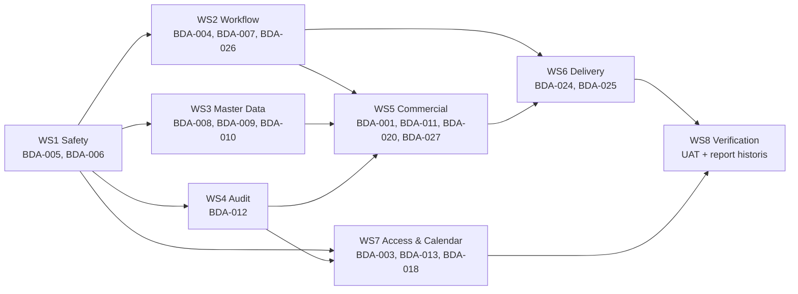

# Phase 2.2 - Implementation Roadmap

**Audit:** Phase 2.2 - Implementation Planning
**Tanggal:** 2026-11-24
**Mode:** Read-only. Roadmap ini belum dieksekusi.

## 1. Prinsip Roadmap

1. **Safety first** - hentikan potensi kehilangan data sebelum menambah fitur.
2. **Satu sumber kebenaran** - status, progress, harga, supplier, dan nomor dokumen.
3. **Additive first** - kolom/tabel baru nullable sebelum constraint dan cleanup.
4. **Data legacy tidak dihapus** sampai mapping dan verifikasi selesai.
5. **Pending/deferred tidak dikerjakan** pada Phase 2.2.

## 2. Workstream dan Dependensi

## 3. Workstream Detail

### WS1 - Data Safety and Archive

**BDA:** BDA-005, BDA-006.
**Tujuan:** menghentikan force delete customer bertransaksi dan Work Type cascade.

| Item | Rencana |
|---|---|
| Model | `Customer`, `WorkType`; tambah scope arsip/aktif |
| Controller | `TrashController@destroyCustomer`, `WorkTypeController@destroy` |
| Policy | `CustomerPolicy::forceDelete`, `ProjectPolicy`; guard transaksi |
| Observer | `CustomerObserver`, `ProjectObserver` |
| Route | Trash customer delete, Work Type delete |
| Frontend | Tombol hapus permanen, dialog arsip, label Work Type |
| Migration | `archived_at/archived_by` customer; `is_active` Work Type; FK work type |
| Test | Force delete dengan invoice/payment harus ditolak; Work Type terpakai tidak bisa dihapus |

**Dependensi:** keputusan representasi arsip (`archived_at` vs `deleted_at`) dan nonaktif vs soft delete Work Type.
**Risiko:** admin kehilangan jalur pembersihan data; perlu arsip yang jelas.

### WS2 - Workflow, Status, and BAST

**BDA:** BDA-004, BDA-007, BDA-026.
**Tujuan:** progress hanya dari workflow, status inti stabil, BAST punya history dan memicu sync.

| Item | Rencana |
|---|---|
| Model | `Project`, `ProjectStatus`, `ProjectDocument`, baru `ProjectBastHistory` |
| Controller | `ProjectController@update`, `BastController`, `ProjectStatusController` |
| Service | `ProjectService`, `ProjectWorkflowService` |
| Policy | `ProjectStatusPolicy` |
| Observer | `ProjectObserver`, observer survey/sizing/install |
| Route | project edit, BAST admin/teknisi, admin panel status |
| Frontend | project form progress read-only, status system badge, BAST history |
| Migration | `project_statuses.code/is_system`, `project_bast_histories`, document versioning |
| Test | Manual progress ditolak; BAST sync; status inti tidak bisa rename/delete |

**Dependensi:** WS1 agar project tidak hilang saat status diubah.
**Risiko:** progress historis bisa berubah setelah workflow dihitung ulang.

### WS3 - Master Data: Supplier, Product, Cost

**BDA:** BDA-008, BDA-009, BDA-010.
**Tujuan:** satu supplier, satu product identity, cost history lengkap.

| Item | Rencana |
|---|---|
| Model | `Supplier`, `Partner`, `Product`, `ProductPriceLog` |
| Controller | `SupplierController`, `PartnerController`, `ProductController` |
| Service | `ProductPriceService` |
| Policy | `ProductPolicy`, `ProposalPolicy` |
| Route | supplier/partner/product/price forms |
| Frontend | supplier selector, product SKU, cost view-only Sales |
| Migration | `partners.supplier_id`, unique `products.sku`, cost log supplier |
| Data | mapping partners type supplier ke suppliers; dedupe SKU |
| Test | Mapping, unique, cost history, kewenangan |

**Dependensi:** WS4 audit untuk mencatat perubahan cost; WS7 untuk policy Sales.
**Risiko:** data partner dan supplier tidak cocok; SKU duplikat menghambat unique index.

### WS4 - Audit and Document Numbers

**BDA:** BDA-012, BDA-011 (numbering only).
**Tujuan:** audit global dan nomor dokumen aman.

| Item | Rencana |
|---|---|
| Model | baru `AuditLog`; `Invoice`, `Payment`, `PurchaseOrder`, `SupplierPurchaseOrder` |
| Controller | `AdminPanelController@auditLog`; mutation endpoints |
| Service | `AuditLogger`, `AdminService`, `ProcurementService` |
| Policy | audit read permission |
| Route | `admin-panel/audit-log`, mutation actions |
| Frontend | audit table/filter |
| Migration | `audit_logs`; index; number sequence/retry |
| Test | Audit immutable, read-only; concurrent number |

**Dependensi:** WS1/WS2 untuk event yang diaudit.
**Risiko:** volume audit; data sensitif perlu redaksi.
**Catatan:** unique `proposals.po_number` **tidak** termasuk karena pending.

### WS5 - Commercial: Invoice, Payment Terms, KPI

**BDA:** BDA-001, BDA-020, BDA-027; BDA-021 pending.
**Tujuan:** invoice sebelum BAST tetap sah; termin fleksibel; omzet dari PO.

| Item | Rencana |
|---|---|
| Model | `Proposal`, `Invoice`, `Payment`, `SalesTarget` |
| Controller | `AdminController`, `ProposalController`, `ManageSalesController` |
| Service | `AdminService`, `SalesKpiService` |
| Policy | `ProposalPolicy`, invoice access |
| Route | invoice/quotation/KPI |
| Frontend | invoice type label, payment schedule, KPI cards |
| Migration | `proposal_payment_terms`, `invoices.payment_term_id` |
| Test | Invoice sebelum BAST; closing butuh BAST; termin; KPI PO |

**Dependensi:** WS3 cost/product; WS2 BAST; WS4 audit.
**Risiko:** definisi omzet mengubah angka historis; termin lama tanpa jadwal.

### WS6 - Delivery and Customer Receipt

**BDA:** BDA-024, BDA-025; BDA-022/023 sudah didukung.
**Tujuan:** status kirim dan terima customer berbeda, bukti, reminder deadline.

| Item | Rencana |
|---|---|
| Model | `GoodsDelivery`, `GoodsDeliveryItem`, baru `GoodsDeliveryReceipt` |
| Controller | `GoodsDeliveryController`, `GoodsReceiptController` |
| Service | `ProcurementService` |
| Policy | delivery access |
| Route | delivery receipt/proof |
| Frontend | status, quantity received, proof upload, overdue |
| Migration | `goods_delivery_receipts` + items; index |
| Test | Partial receipt customer, proof, closing |

**Dependensi:** WS2 BAST/closing; WS2 progress.
**Risiko:** data delivered lama tidak punya bukti; perlu status legacy.

### WS7 - Access, Cost Policy, Calendar

**BDA:** BDA-003, BDA-013, BDA-018; BDA-016 optional.
**Tujuan:** hanya Estimator ubah cost, Sales scope tertutup, kalender meeting-only.

| Item | Rencana |
|---|---|
| Model | `Customer`, `Lead`, `Product`, `SalesSchedule` |
| Controller | `LeadController@promoteCustomer`, `WhatsAppCenterController@convert`, `SalesScheduleController` |
| Service | `CustomerLifecycleService`, `CustomerContactService` |
| Policy | `ProductPolicy`, `CustomerPolicy`, `LeadPolicy` |
| Route | cost form, calendar |
| Frontend | read-only cost, calendar filter |
| Migration | tidak wajib; index ownership |
| Test | Sales tidak bisa ubah cost; customer/PT isolation; calendar hanya meeting |

**Dependensi:** WS3 product/cost; WS4 audit.
**Risiko:** Sales kehilangan akses data lama; agenda non-meeting perlu tempat baru.

### WS8 - Verification and UAT

**BDA:** semua.
**Tujuan:** verifikasi lintas peran dan data historis.

- Regression suite.
- Staging PostgreSQL.
- UAT Sales, Estimator, Admin/Purchasing, Finance, Teknisi, Management.
- Cek laporan historis customer arsip.
- Cek closing, invoice, payment, BAST.

## 4. Urutan Implementasi

| Urutan | Workstream | BDA | Prasyarat | Output |
|---:|---|---|---|---|
| 0 | Preflight | - | Backup, staging, data profiling | Baseline |
| 1 | WS1 Safety | BDA-005/006 | Keputusan arsip/nonaktif | Guard + kolom |
| 2 | WS4 Audit | BDA-012 | WS1 event | Audit log |
| 3 | WS2 Workflow | BDA-004/007/026 | WS1/WS4 | Satu progress, status inti, BAST history |
| 4 | WS3 Master | BDA-008/009/010 | WS4 | Supplier/product/cost |
| 5 | WS7 Access | BDA-003/013/018 | WS3/WS4 | Policy + calendar |
| 6 | WS5 Commercial | BDA-001/020/027 | WS2/WS3/WS4 | Invoice/term/KPI |
| 7 | WS6 Delivery | BDA-024/025 | WS2/WS5 | Receipt customer |
| 8 | WS8 UAT | Semua | Semua | Sign-off |

## 5. Perubahan per Lapisan

### Model
`Customer` (`archived_at`), `WorkType` (`is_active`), `ProjectStatus` (`code/is_system`), `Project` (derived progress), `ProjectDocument` (versioned BAST), `GoodsDelivery`/new receipt, `Proposal`/`Invoice` payment terms, `ProductPriceLog`, `AuditLog`.

### Controller
`TrashController`, `WorkTypeController`, `ProjectController`, `BastController`, `ProjectStatusController`, `AdminController`, `ProposalController`, `GoodsDeliveryController`, `ProductController`, `LeadController`, `WhatsAppCenterController`, `SalesScheduleController`, `AdminPanelController`.

### Service
`ProjectService`, `ProjectWorkflowService`, `AdminService`, `ProcurementService`, `ProductPriceService`, `SalesKpiService`, `CustomerLifecycleService`, baru `AuditLogger`.

### Policy/Gate
`CustomerPolicy`, `ProjectPolicy`, `ProductPolicy`, `ProposalPolicy`, `ProjectStatusPolicy`, `LeadPolicy`; tambah permission audit/cost.

### Observer
`CustomerObserver`, `ProjectObserver`, `SurveyObserver`, `SizingProjectObserver`, `InstalasiObserver`; observer baru untuk BAST/delivery receipt/audit.

### Route
`trash`, `admin-panel/work-types`, `admin-panel/project-statuses`, `admin-panel/audit-log`, `admin/bast`, `admin/invoices`, `admin/goods-deliveries`, `sales/schedules`, `products`.

### Frontend
Project form, status admin, supplier/product, cost read-only, calendar, invoice/term, KPI, delivery receipt, BAST history, audit log.

### Test
Feature/unit per workstream, migration tests, PostgreSQL integration, UAT.

## 6. Yang Tidak Dikerjakan

| Item | Alasan |
|---|---|
| BDA-015 SLA 0/15/30 | Deferred |
| BDA-021 target margin minimum | Pending |
| Unique PO customer | Pending |
| Retur barang | Belum ada keputusan |
| Role Sales Leader baru | Keputusan BDA-019 menyatakan tidak perlu |
| Hapus tabel `partners`/`purchase_orders`/`request_hargas` | Harus mapping dulu |
| Rename massal status | Menunggu kode sistem |

## 7. Definition of Done per Workstream

- Migration dan rollback diuji di PostgreSQL staging.
- Data migration idempotent dan punya laporan hasil.
- Test positif/negatif lulus.
- UI light/dark/mobile diperiksa bila berubah.
- Audit log mencatat perubahan penting.
- UAT per peran disetujui.
- Dokumentasi SOP dan catatan rilis diperbarui.

## 8. Status

Roadmap ini belum dieksekusi. Tidak ada source code, migration, schema, atau data yang diubah.
