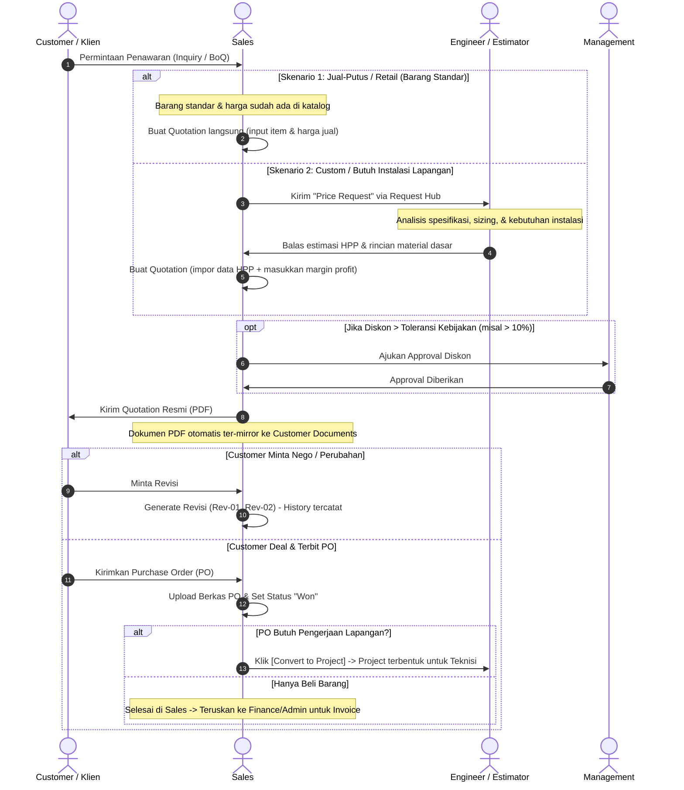

# Rencana Perubahan & Revamp Menu: Proposal Menjadi Quotation (Penawaran Harga)

---

## 1. Ringkasan Eksekutif & Latar Belakang

### 1.1 Masalah & Temuan
1. **Ambiguitas Terminologi ("Proposal"):**
   * Kata "Proposal" menimbulkan kerancuan. Pengguna dan tim developer sering menganggapnya sebagai dokumen naratif (seperti proposal skripsi, event, atau sponsorship), padahal secara fungsional di sistem ini isinya adalah **Surat Penawaran Harga (SPH / Quotation)** yang berisi rincian item barang, kuantitas, harga, kalkulasi diskon, dan PPN.
2. **Kekhawatiran Redundansi Berkas (Masukan Senior):**
   * Ada pandangan bahwa menu Proposal tidak perlu ada karena file-file dokumen penawaran seharusnya terpusat dan langsung terhubung di tab **Documents** pada detail **Customer**.
3. **Ketidakjelasan Tanggung Jawab Perhitungan:**
   * Belum ada batasan tegas mengenai siapa yang menghitung apa: apakah Sales yang menginput harga sendiri, atau tim Engineer yang menentukan estimasi teknis lapangan.

### 1.2 Sasaran Transformasi
* Melakukan *rebranding* dan restrukturisasi dari **Proposal** menjadi **Quotation (Penawaran Harga)**.
* Mengintegrasikan alur **Perhitungan Teknis (HPP)** oleh Tim Engineer dengan **Perhitungan Komersial (Harga Jual/Margin)** oleh Sales.
* Menerapkan mekanisme **Document Mirroring**: PDF Quotation otomatis terhubung dan muncul di tab *Documents* pada profil Customer tanpa perlu upload manual dua kali.

---

## 2. Definisi Peran & Tanggung Jawab Perhitungan (Who Calculates What?)

Di bisnis integrasi teknologi / B2B, penentuan harga memiliki dua lapisan yang berbeda dan tidak boleh dicampuradukkan:

```
┌─────────────────────────────────────────────────────────────┐
│ 1. LAPIS TEKNIS: HPP & Estimasi Material                    │
│    PIC: Tim Engineer / Estimator / Purchasing               │
│    Media: Menu "Request Hub" -> Tab "Price" (Price Request) │
│    Output: Rincian BoM (Bill of Materials) & Ongkos Jasa    │
└──────────────────────────────┬──────────────────────────────┘
                               │ (Handover HPP / Estimasi)
                               ▼
┌─────────────────────────────────────────────────────────────┐
│ 2. LAPIS KOMERSIAL: Margin, Diskon & Penawaran Final        │
│    PIC: Sales (dengan Approval Management jika perlu)       │
│    Media: Modul "Quotation"                                 │
│    Output: Surat Penawaran Harga Resmi (PDF) ke Klien       │
└─────────────────────────────────────────────────────────────┘
```

### Rincian Tanggung Jawab:

| Komponen | Penanggung Jawab | Deskripsi / Parameter |
|---|---|---|
| **Sizing & Spesifikasi Barang** | Engineer / Teknisi | Menentukan tipe barang, kapasitas, dan kompatibilitas sistem. |
| **Kebutuhan Material Bantu** | Engineer / Teknisi | Estimasi kabel, pipa, bracket, aksesoris instalasi. |
| **Estimasi Jasa / Man-days** | Engineer / Lead Tek | Estimasi durasi pengerjaan lapangan & jumlah teknisi. |
| **Harga Modal / HPP** | Purchasing / Engineer | Harga beli barang dari distributor/prinsipal. |
| **Margin Keuntungan (Markup)** | Sales | Persentase margin profit sesuai target perusahaan. |
| **Diskon Negosiasi** | Sales / Management | Diskon komersial (diskon besar wajib persetujuan Management). |
| **Pajak (PPN) & Syarat Bayar** | Sales / Finance | Kalkulasi PPN 11%/12% dan termin pembayaran (TOP). |

---

## 3. Alur Kerja Sistem (End-to-End Workflow)



---

## 4. Solusi Integrasi Dokumen Customer (Document Mirroring)

Untuk menjawab kekhawatiran bahwa berkas seharusnya berada di Customer:
1. **Prinsip Single Source of Truth:**
   * File PDF Quotation dihasilkan dari data tabel `quotations` & `quotation_items`.
2. **Mirroring Otomatis ke Menu Customer:**
   * Di halaman **Detail Customer -> Tab Documents**, sistem menampilkan dua kelompok dokumen:
     1. **Dokumen Induk Customer:** NPWP, NIB, KTP PIC, Kontrak Payung/MOU (diunggah manual).
     2. **Dokumen Transaksional (Otomatis):**
        * Daftar Quotation (Nomor, Tanggal, Nilai, Status, Link Unduh PDF).
        * Dokumen PO yang di-upload pada penawaran yang sudah deal.
3. **Keuntungan:**
   * Senior puas karena dari halaman Customer semua berkas penawaran klien terlihat lengkap.
   * Sales & Developer puas karena data nilai rupiah, pipeline omzet, dan rincian barang tetap terstruktur di database.

---

## 5. Rencana Perubahan Teknis (Implementation Phases)

### Fase 1: Penyesuaian Naming & Bahasa (UI / UX Layer)
* **Sidebar & Menu:**
  * Ubah label `Proposal` menjadi `Quotation` (Bahasa Inggris) dan `Penawaran` (Bahasa Indonesia).
  * Update icon jika perlu (menggunakan icon standar konvensi `x-icon-button` / Heroicons).
* **Breadcrumbs & Page Titles:**
  * Ganti `Proposals` -> `Quotations`.
  * Ganti `Create Proposal` -> `Create Quotation`.
* **Nomor Dokumen:**
  * Ubah format penomoran default dari `PROP/YYYY/MM/...` menjadi `QUO/YYYY/MM/...` atau `SPH/YYYY/MM/...`.

### Fase 2: Sinkronisasi dengan Modul "Price Request" (Request Hub)
* Pada halaman detail **Price Request** yang sudah dijawab oleh Engineer:
  * Tambahkan tombol aksi: `<x-icon-button icon="add" label="Create Quotation from this Request" ... />`.
  * Saat diklik, sistem membuka form Quotation baru dengan `customer_id` dan catatan spesifikasi teknis yang otomatis terisi.

### Fase 3: Integrasi Mirroring ke Customer Detail
* Perbarui view `customers/show.blade.php` pada tab dokumen/transaksi:
  * Tambahkan sub-tabel atau widget ringkasan:
    * *Quotations History* (menampilkan status: Draft, Sent, Won, Lost, Expired).
    * Tombol unduh PDF per Quotation.

### Fase 4: Database & Code Cleanliness (Non-Destructive)
* Untuk menjaga kompatibilitas codebase yang sedang berjalan paralel di cabang lain:
  * Gunakan Eloquent Alias / Resource Wrapper: `class Quotation extends Proposal {}` atau refactor nama model secara bertahap saat konsolidasi branch.
  * Hindari perubahan skema database yang destruktif sesuai aturan kebersihan dan keamanan database.

---

## 6. Matriks Perbandingan: Sebelum vs Sesudah

| Aspek | Kondisi Lama (Proposal) | Kondisi Baru (Quotation) |
|---|---|---|
| **Istilah** | "Proposal" (rancu dengan proposal umum/narasi) | "Quotation" / "Penawaran Harga" (standar B2B) |
| **Keterkaitan Tim Teknis** | Tidak jelas siapa yang menghitung HPP | Jelas: Engineer hitung via *Price Request*, Sales tentukan margin & penawaran final |
| **Aksesibilitas Dokumen** | Terisolasi di modul proposal saja | Terintegrasi: Otomatis muncul di profil *Customer Detail* |
| **Tindak Lanjut PO** | Konversi proyek tidak terdefinisi jelas | Terarah: Jual putus (Billing saja) vs Jasa/Proyek (Convert to Project) |
| **Audit Revisi** | Berisiko timpa file atau manual luar sistem | Terstruktur: Quotation Rev 00, 01, 02 dengan catatan perubahan harga |

---

## 7. Rekomendasi Langkah Selanjutnya

1. **Review dengan Senior & Tim:** Tunjukkan dokumen ini untuk menyamakan persepsi bahwa Quotation tetap dipertahankan sebagai entitas data, namun output PDF-nya terintegrasi penuh ke modul Customer.
2. **Eksekusi Bertahap:** Mulai dari Fase 1 (labeling & UX) di branch `feature/sales-flow`.
3. **Dokumentasikan Komponen Tombol:** Pastikan seluruh tombol baru mematuhi aturan styling di `AGENTS.md` (menggunakan `<x-icon-button>`, warna solid, tanpa transparansi).
